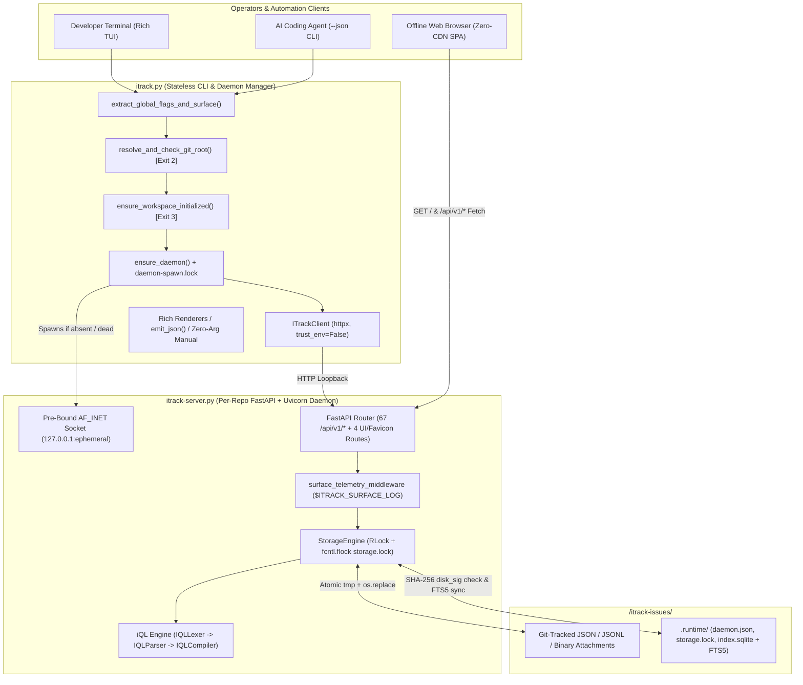

# iTrack v2.0.0 — Exhaustive System Architecture & Technical Specification (`SPEC.md`)

> **Document Scope & Ground-Truth Guarantee:** This specification documents the exact, verified "as-is" implementation of **iTrack v2.0.0** (`itrack.py`, `itrack-server.py`, `itrack-requirements.txt`, and `tests/`). Every architectural invariant, file path, line range, JSON schema, SQLite3/FTS5 table and index, iQL grammar production, FastAPI route, CLI subcommand, CLI option flag, embedded Single-Page Application (SPA) view/modal, environment variable, and known limitation has been derived directly from full line-by-line traversal of the source code.

---

## 1. Project Overview & Core Purpose

**iTrack** (`v2.0.0`) is a **Git-rooted, local-first, air-gapped issue tracker, Agile project management suite, and AI-agent collaboration engine** designed to store canonical project state directly inside a target Git repository's working tree (`<target-git-root>/itrack-issues/`) while serving fast, concurrent queries and a rich zero-CDN offline Web UI from a self-healing per-repository background daemon.

### 1.1 Core Architectural Laws & Design Goals
1. **Law 1 — Clean Repository Root:** The iTrack codebase root contains strictly its allowed source, specification, and test entries (`itrack.py`, `itrack-server.py`, `itrack-requirements.txt`, `tests`, `SPEC.md`, `todo.md`, `.env.example`), with zero stray caches (`__pycache__`, `.pytest_cache`, `.coverage`), build metadata, or test workspace directories (`tests/helpers.py`, `L45–54`, `L208–262`).
2. **Law 2 — Strict Git-Root Execution Boundary:** Both `itrack.py` (`resolve_and_check_git_root`, `L391–427`) and `itrack-server.py` (`check_and_resolve_git_root`, `L395–440`) enforce that the target workspace directory is a valid Git repository root (supporting standard `.git/` directories, Git worktree `.git` files, and symlinks pointing directly to a Git root). Invoking either executable outside a Git repository or inside a Git subdirectory immediately aborts with **exit code `2`** (emitting a `git rev-parse --show-toplevel` directory hint when inside a subdirectory) without creating files or spawning processes.
3. **Folder-Per-Issue Human-Readable Persistence:** Every issue is stored as an exact, human-readable directory `<target-git-root>/itrack-issues/issues/<Exact Issue Name>/` preserving spaces, punctuation, and Unicode characters verbatim (`itrack-server.py`, `L240–256`, `L2863`). Renaming an issue atomically renames its on-disk folder (`os.replace`, including two-hop case-only renames on case-insensitive filesystems) while preserving its immutable sequential key (`ITR-1`, `ITR-2`, ...) and updating cached link names across peer issues (`itrack-server.py`, `L2930–3004`).
4. **Dual Issue Addressing Everywhere:** Every CLI command, REST API route (`{issue_ref}`), and Web UI permalink accepts **either** the immutable key (`ITR-1`, `itr-1`, `#ITR-1`) **or** the exact issue folder name with spaces (`"OAuth2 Token Refresh Race Condition"`) (`itrack-server.py`, `L1903–1941`; `itrack.py`, `L133–144`).
5. **Derived, Self-Healing Hybrid SQLite3 + FTS5 Cache:** Git tracks only deterministic JSON, JSONL, and binary attachment files under `itrack-issues/`, while `itrack-issues/.gitignore` excludes `.runtime/`, `index.sqlite*`, and `*.tmp` (`itrack-server.py`, `L136`). Inside `itrack-issues/.runtime/index.sqlite`, `StorageEngine` maintains a WAL-mode SQLite3 relational and FTS5 full-text index synchronized via SHA-256 disk-state signatures (`_compute_disk_signature`, `L1406–1439`). Any out-of-band `git pull`, manual JSON edit, manual folder rename, or database file deletion/corruption is automatically detected on the next read or write lock acquisition and healed from the canonical on-disk folders (`itrack-server.py`, `L1554–1840`).
6. **100% Bidirectional CLI <-> REST API <-> Offline Web SPA Parity:**
   - **CLI (`itrack.py`):** 72 leaf subcommands across 12 command groups and 10 top-level commands, 90 canonical `--*` option flags, Rich TUI output + deterministic `--json` output, strict exit codes `0..5`, auto-spawning per-repo daemon management, and a programmatic zero-drift self-teaching manual (`python itrack.py` with zero arguments).
   - **Daemon & REST API (`itrack-server.py`):** FastAPI + Uvicorn HTTP server binding `127.0.0.1` (default ephemeral `--port 0`), exposing 67 `/api/v1/*` REST routes plus 4 UI/favicon routes, custom recursive-descent **iQL (iTrack Query Language)** compiler, and `fcntl.flock` multi-process concurrency safety.
   - **Air-Gapped Single-Page Web UI (`SPA_HTML` in `itrack-server.py`):** Zero-CDN vanilla HTML5/CSS3/JS application with 8 primary navigation views, full-page `#/issues/<ref>` permalinks, 10 modal/drawer surfaces, dual HTML5 + pointer-event Kanban drag-and-drop across 11 workflow states and 5 swimlane modes, XSS-safe Markdown rendering, and 3-way inline image embedding (file picker, drag-and-drop, and clipboard `Ctrl+V` paste).

---

## 2. Tech Stack, Versions & Runtime Requirements

### 2.1 Language & Operating System Requirements
- **Python:** Python `>= 3.10` required (`from __future__ import annotations` + `X | Y` union syntax in `itrack.py` and `tests/`); verified on **Python `3.12.16`** (CPython, Linux `ubuntu 24.04`). On Python `>= 3.12`, `tests/run_all.py` (`L106`) automatically enables `core = sysmon` (`sys.monitoring`) in `.coveragerc` for low-overhead subprocess coverage collection.
- **POSIX System Dependencies:**
  - `fcntl.flock` (POSIX advisory file locking) is used in `itrack.py` (`L8`, `L355`, `L545`, `L1089`), `itrack-server.py` (`L12`, `L505`, `L561`, `L1331`), and `tests/helpers.py` (`L6`, `L615`, `L630`). Works natively on **Linux** and **macOS**; **Windows is not supported** without WSL2 because `fcntl` is POSIX-only.
  - `git` CLI (`>= 2.25`) on `PATH` for Git-root/subdirectory resolution (`git rev-parse --show-toplevel`), default user detection (`git config user.name`), and test worktree creation (`git worktree add`).
  - SQLite3 with **FTS5** extension compiled into Python's standard-library `sqlite3` module (standard in official Python builds on Linux and macOS).
  - Headless Chromium binary installed via `python -m playwright install chromium` (required only for Playwright UI test suites `test_07` and `test_08`).

### 2.2 Python Package Dependencies (`itrack-requirements.txt`, `L1–9`)
| Package | Declared Constraint (`itrack-requirements.txt`) | Verified Cloud Venv Version | Role in System |
|---|---|---|---|
| `fastapi` | `>=0.110.0` | `0.165.0` (Starlette `1.10.0`) | HTTP routing, `Request` form/JSON handling, `FileResponse`, `CORSMiddleware`, and `lifespan` management in `itrack-server.py`. |
| `uvicorn` | `>=0.29.0` | `0.54.0` | ASGI HTTP server executing `itrack-server.py` against a pre-bound `AF_INET` socket (`server.run(sockets=[sock])`). |
| `pydantic` | `>=2.6.0` | `2.14.4` | Transitive/declared FastAPI dependency (note: `itrack-server.py` performs explicit dict/query validation rather than defining `BaseModel` subclasses). |
| `python-multipart` | `>=0.0.9` | `0.0.34` | Required by FastAPI/Starlette `await request.form()` for multipart file uploads (`/embeds`, `/attachments`, `/comments`). |
| `httpx` | `>=0.27.0` | `0.28.1` | Synchronous HTTP client in `itrack.py` (`ITrackClient`, `probe_daemon`, `stop_daemon`, `cmd_ui`) and `tests/helpers.py`, always configured with `trust_env=False`. |
| `rich` | `>=13.7.0` | `15.0.0` | Terminal tables (`Table`), bordered panels (`Panel`), hierarchy trees (`Tree`), and progress bars in `itrack.py`. |
| `pytest` | `>=8.0.0` | `9.2.0` | Test execution framework across `tests/test_01_*.py` through `tests/test_09_*.py`. |
| `coverage` | `>=7.4.0` | `7.17.5` | Multi-process line coverage measurement (`coverage.process_startup()` via `/tmp` `sitecustomize.py`) in `tests/run_all.py`. |
| `playwright` | `>=1.42.0` | `1.65.2` | Synchronous headless Chromium browser automation (`playwright.sync_api`) in `tests/conftest.py`, `test_07`, and `test_08`. |

---

## 3. Annotated Repository Map

### 3.1 Codebase Repository Layout (`itrack/`)
Per **Clean-Root Law** (`EXPECTED_ROOT_ENTRIES` in `tests/helpers.py`), the repository root contains strictly the following 7 top-level entries (excluding `.git/`):

```text
itrack/
├── .env.example                                                     # Documented environment variables template (no secrets required)
├── SPEC.md                                                          # This exhaustive technical specification & verification baseline
├── todo.md                                                          # Prioritized engineering roadmap & backlog
├── itrack.py                                                        # (3,632 lines) Git-rooted CLI, Rich TUI, auto-daemon spawner & zero-arg manual
├── itrack-server.py                                                 # (8,767 lines) FastAPI daemon, StorageEngine, SQLite/FTS5, iQL & offline SPA
├── itrack-requirements.txt                                          # (9 lines) Runtime and verification Python dependencies
└── tests/                                                           # (12 files, 15,185 lines, 88 pytest test functions)
    ├── conftest.py                                                  # (252 lines) Pytest fixtures: git_repo, workspace, live_ui (Playwright)
    ├── helpers.py                                                   # (1,664 lines) Clean-Root guard, /proc daemon reaper, asset builders, surface audit
    ├── run_all.py                                                   # (879 lines) 3-stage parallel test runner, subprocess coverage & 100% surface gate
    ├── test_01_guardrails_config_server_and_manual.py               # (1,887 lines, 17 tests) Laws 1 & 2, init, config, daemon lifecycle, manual
    ├── test_02_issue_crud_every_field_set_edit_and_clear.py         # (1,303 lines, 14 tests) Exhaustive issue create/show/edit/clear/clone/archive/delete
    ├── test_03_folder_renames_with_spaces.py                        # (756 lines, 5 tests) Atomic folder renames with spaces, Unicode, case-only & cycles
    ├── test_04_rich_comments_embeds_and_attachments_matrix.py       # (1,204 lines, 9 tests) Comments, embeds, attachments, cross-links & tombstones
    ├── test_05_hierarchy_links_search_pagination_and_agile.py       # (2,539 lines, 27 tests) Links, tree, 80-issue iQL/FTS5/sort/page, board, Agile, stats
    ├── test_06_real_world_human_and_agent_workflows.py              # (1,025 lines, 3 tests) End-to-end SEV1 incident, multi-epic sprint & security purge
    ├── test_07_playwright_full_web_ui_every_feature.py              # (1,511 lines, 5 tests) Headless Chromium E2E across all 8 views & 10 modals
    ├── test_08_bidirectional_cli_ui_parity_and_100pct_gate.py       # (1,457 lines, 3 tests) UI<->CLI round-trips + cumulative 100% surface gate
    └── test_09_concurrent_agent_stress_and_self_healing.py          # (708 lines, 5 tests) Multi-process stampede, swarm creates, rename under fire & self-heal
```

### 3.2 Target Workspace On-Disk Layout (`<target-git-root>/itrack-issues/`)
When `python itrack.py init` (or `python itrack-server.py --init`) runs inside any target Git repository root, it creates and manages the following structure:

```text
<target-git-root>/
├── .git/                                          # Directory (standard clone) or file (git worktree)
└── itrack-issues/
    ├── .gitignore                                 # Ignores: .runtime/, index.sqlite*, *.tmp
    ├── config.json                                # Project settings, defaults, WIP limits & next_*_seq counters
    ├── tags.json                                  # {"tags": [...]} colored tag definitions
    ├── sprints.json                               # {"sprints": [...]} Agile sprint definitions
    ├── milestones.json                            # {"milestones": [...]} release milestone definitions
    ├── views.json                                 # {"views": [...]} named Saved Views (iQL + tab + sort + swimlane)
    ├── .runtime/                                  # Git-ignored local daemon & derived index state
    │   ├── storage.lock                           # fcntl.flock file for StorageEngine (LOCK_SH / LOCK_EX)
    │   ├── daemon-spawn.lock                      # fcntl.flock file serializing concurrent CLI cold-starts
    │   ├── daemon.json                            # Active server {pid, host, port, base_url, repo_root, started_at, version}
    │   ├── daemon.log                             # Captured stdout/stderr from background-spawned itrack-server.py
    │   ├── index.sqlite                           # Derived SQLite3 + FTS5 relational/full-text index (WAL mode)
    │   ├── index.sqlite-wal                       # SQLite Write-Ahead Log file
    │   └── index.sqlite-shm                       # SQLite shared-memory WAL index
    └── issues/
        └── <Exact Issue Name>/                    # 1..180 chars; preserves spaces, symbols & Unicode verbatim
            ├── issue.json                         # Canonical 30-field issue state document
            ├── history.jsonl                      # Append-only chronological diff audit log (HST-1, HST-2, ...)
            ├── attachments/                       # Whole-issue files (scope="issue") & description embeds (scope="description_embed")
            │   └── ATT-<seq>_<safe_suffix>
            └── comments/
                └── CMT-<seq>/
                    ├── comment.json               # Comment body, author, embeds, attachments, linked_attachment_ids, edit_history
                    └── files/                     # Comment inline embeds (scope="comment_embed") & files (scope="comment")
                        └── ATT-<seq>_<safe_suffix>
```

---

## 4. System Architecture & Execution Flows

### 4.1 Component Architecture Diagram


### 4.2 Cold-Start Auto-Daemon Spawn, Mutation & Self-Healing Sequence
```mermaid
sequenceDiagram
    participant Agent as "CLI Caller (itrack.py)"
    participant SpawnLock as ".runtime/daemon-spawn.lock"
    participant Daemon as "itrack-server.py (FastAPI)"
    participant StoreLock as ".runtime/storage.lock"
    participant Disk as "itrack-issues/ (JSON + Attachments)"
    participant SQLite as ".runtime/index.sqlite (WAL + FTS5)"

    Agent->>Agent: "1. Parse global --json/--root & verify .git at root (Exit 2 on fail)"
    Agent->>Agent: "2. Verify config.json exists (Exit 3 on fail, except init)"
    Agent->>Daemon: "3. probe_daemon(): read daemon.json, kill(pid,0), GET /api/v1/health"
    alt "Daemon not running or stale PID"
        Agent->>SpawnLock: "4a. fcntl.flock(LOCK_EX) — serialize concurrent cold-starts"
        Agent->>Daemon: "4b. Re-probe inside lock; if still down, Popen(itrack-server.py --port 0)"
        Daemon->>StoreLock: "4c. StorageEngine.__init__ -> write_lock() (LOCK_EX)"
        Daemon->>Disk: "4d. Compute SHA-256 _compute_disk_signature()"
        Daemon->>SQLite: "4e. Build/heal schema & index all issues/comments/links/FTS5"
        Daemon->>Disk: "4f. Lifespan writes .runtime/daemon.json atomically"
        Agent->>Daemon: "4g. Poll /api/v1/health every 40ms (up to 12.0s) until HTTP 200"
        Agent->>SpawnLock: "4h. fcntl.flock(LOCK_UN)"
    end
    Agent->>Daemon: "5. HTTP Request (e.g. POST /api/v1/issues)"
    Daemon->>StoreLock: "6. Acquire RLock + fcntl.flock(LOCK_EX)"
    Daemon->>SQLite: "7. Verify PRAGMA quick_check(1), issues_fts & meta.disk_sig"
    alt "Out-of-band git pull or SQLite corruption detected"
        Daemon->>SQLite: "7a. Auto-wipe if corrupt & _rebuild_index_unlocked() + resync next_*_seq"
    end
    Daemon->>Disk: "8. Write issue.json, history.jsonl & config.json via .tmp + os.replace()"
    Daemon->>SQLite: "9. Update issues, issue_tags, issue_components, issue_links, issues_fts & disk_sig"
    Daemon->>StoreLock: "10. Commit SQLite & release LOCK_EX"
    Daemon-->>Agent: "11. Return enriched JSON (HTTP 201)"
    Agent-->>Agent: "12. Render Rich Panel/Table or emit_json() and exit 0"
```

### 4.3 Execution Flow Details
1. **Zero-Arg & Early-Exit Flow (`itrack.py`, `L3574–3600`):**
   - `extract_global_flags_and_surface(argv, parser)` (`L253–343`) scans raw `sys.argv[1:]` before `argparse.parse_args()`, extracting `--json` and `--root` from **any** position prior to `--` while recording the canonical subcommand path and `--*` flags to `$ITRACK_SURFACE_LOG` (`record_cli_surface`, `L346–362`).
   - `-V` / `--version` prints `itrack 2.0.0` (or `{"name": "itrack", "version": "2.0.0"}` in `--json` mode) and exits `0` **without** requiring a Git root.
   - `-h` / `--help` delegates directly to `argparse` help output and exits `0` **without** requiring a Git root.
   - Invoking `python itrack.py` with **zero subcommands** validates Law 2 Git-root (`resolve_and_check_git_root`), then prints the complete programmatic Markdown manual (`render_zero_arg_manual`, `L3561–3566`) or structured JSON catalog (`--json`) and exits `0` **without** requiring `itrack init` or spawning a daemon.
2. **Cold-Start Stampede Protection (`itrack.py`, `L527–608`):**
   - When 15+ concurrent agent processes invoke `itrack.py` simultaneously against a cold workspace, all processes contend on `fcntl.flock(LOCK_EX)` over `itrack-issues/.runtime/daemon-spawn.lock`.
   - The first process spawns `itrack-server.py --root <repo> --host 127.0.0.1 --port <port>` (`start_new_session=True`, stdout/stderr redirected to `.runtime/daemon.log`) and polls `probe_daemon()` every `40ms` up to `12.0s`.
   - Subsequent processes acquire `daemon-spawn.lock`, immediately see the live daemon via `probe_daemon()`, and reuse it without spawning duplicate servers.

---

## 5. Module-by-Module Functional Breakdown

### 5.1 `itrack.py` (`3,632` lines, `159,547` bytes) — CLI Client, Rich TUI & Daemon Manager
- **Constants, Styles & Error Model (`L31–232`):**
  - Canonical enum lists (`L33–60`), `EXIT_CODE_DOCS` (`L61–68`), Rich color maps (`STATE_STYLES`, `PRIORITY_STYLES`, `SEVERITY_STYLES`, `L70–99`), `CLIError(message, error_code, exit_code)` (`L107–114`), `http_status_to_exit_code` (`L121–130`), `normalize_ref_str` & `encode_ref` (`L133–144`), `parse_issue_refs` (`L167–181`, smartly distinguishes comma-separated keys `ITR-1,ITR-2` from an actual on-disk issue folder whose name contains a comma!), `default_actor` (`L184–204`), `handle_cli_error` (`L212–222`), and `require_yes` (`L225–231`).
- **Position-Independent Flag Extractor & CLI Surface Telemetry (`L239–362`):**
  - `extract_global_flags_and_surface` (`L253–343`) walks the subparser tree to extract `--json` and `--root` regardless of whether the caller writes `itrack.py --json issue list` or `itrack.py issue list --json`, and `record_cli_surface` (`L346–362`) appends `{"kind": "cli_exec", "command": ..., "flags": ...}` to `$ITRACK_SURFACE_LOG`.
- **Pre-Flight Guards (`L370–439`):**
  - `detect_git_toplevel_hint` (`L370–388`), `resolve_and_check_git_root` (`L391–427`, exit `2`), and `ensure_workspace_initialized` (`L430–439`, exit `3`).
- **Daemon Lifecycle & HTTP Client (`L447–780`):**
  - `probe_daemon` (`L486–506`, checks `daemon.json`, `os.kill(pid, 0)`, and `GET /api/v1/health` with `2.0s` timeout and exact `repo_root` match), `locate_server_script` (`L509–513`), `spawn_daemon` (`L527–608`), `ensure_daemon` (`L610–616`), `stop_daemon` (`L619–666`, posts `/api/v1/shutdown`, polls `3.5s`, escalates to `SIGTERM` + `2.0s` poll, unlinks `daemon.json`), `ITrackClient` (`L669–754`, `timeout=30.0`, `trust_env=False`), `validate_upload_paths` & `open_multipart_files` (`L757–780`).
- **Rich TUI Renderers (`L788–1036`):**
  - `make_bar` & `render_time_bar` (`L806–820`), `render_issues_table` (`L823–862`), `render_comment_panel` (`L865–911`, including `[deleted attachment: ATT-X (filename)]` strike-through rendering for tombstoned attachments), and `render_issue_detail` (`L914–1036`).
- **Command Handlers (`L1044–2918`):**
  - Workspace & System: `cmd_init` (`L1063–1174`), `cmd_status` (`L1177–1199`), `cmd_reindex` (`L1202–1212`), `_parse_config_value` & `cmd_config` (`L1215–1252`), `cmd_server` (`L1255–1313`), `cmd_ui` (`L1316–1392`), `cmd_stats` (`L1395–1444`), `_populate_rich_tree` & `cmd_tree` (`L1447–1479`), `cmd_search` (`L1482–1499`), `cmd_board` (`L1502–1557`), `cmd_history` (`L1560–1587`).
  - Entity Groups: `_read_markdown_source` (`L1595–1626`, mutually exclusive text / file / stdin reader), `_parse_key_val_pairs` (`L1629–1650`), `cmd_issue` (`L1653–2082`), `cmd_comment` (`L2085–2220`), `cmd_attach` (`L2223–2312`), `cmd_link` (`L2315–2365`), `cmd_tag` (`L2368–2422`), `cmd_sprint` (`L2425–2567`), `cmd_milestone` (`L2570–2668`), `cmd_view` (`L2671–2770`), `cmd_worklog` (`L2773–2834`), `cmd_bulk` (`L2837–2918`).
- **Parser, Programmatic Manual & Entrypoint (`L2926–3632`):**
  - `CLIArgumentParser` (`L2926–2930`, overrides `error()` to raise `CLIError(..., exit_code=1)` instead of `argparse`'s default exit `2`, preserving exit `2` strictly for Law 2 Git-root failures), `build_parser` (`L2933–3394`), `collect_parser_catalog` (`L3402–3443`), `generate_manual_markdown` (`L3446–3527`), `build_manual_payload` & `render_zero_arg_manual` (`L3530–3566`), and `main` (`L3574–3628`).

### 5.2 `itrack-server.py` (`8,767` lines, `411,736` bytes) — Daemon, StorageEngine, iQL & Offline SPA
- **Section 1: Canonical Enums, Ranks & Constants (`L38–143`):**
  - `CATEGORIES`, `STATES`, `PRIORITIES`/`PRIORITY_RANKS`, `SEVERITIES`/`SEVERITY_RANKS`, `RESOLUTIONS`, `LINK_TYPES`/`INVERSE_LINK_TYPES`, `PRESET_TABS`, `SWIMLANES`, `TERMINAL_STATES`, `GITIGNORE_CONTENT`, `IMAGE_EXTENSIONS` (8 extensions), `TEXT_PREVIEW_EXTENSIONS` (27 extensions).
- **Section 2: Normalization, Validation & Pre-Flight Helpers (`L146–569`):**
  - Enum normalizers (`L162–237`), `validate_issue_name` (`L240–256`), `validate_calendar_date` (`L259–271`), `validate_story_points` (`L274–283`), `validate_estimate_minutes` (`L286–302`), `parse_duration_minutes` (`L304–331`), `sanitize_filename` (`L334–345`), `is_image_file` & `is_text_previewable` (`L348–365`), `detect_default_user` (`L368–383`), `resolve_raw_root_arg` & `check_and_resolve_git_root` (`L386–440`), `default_config_dict` (`L443–474`), `_atomic_write_bytes` & `_atomic_write_json_standalone` (`L477–488`), `init_workspace_on_disk` (`L491–549`), and `record_surface_event` (`L552–568`).
- **Section 3: Recursive-Descent iQL Engine (`L571–1272`):**
  - `IQLError` (`L575–580`), `Token` (`L582–590`), `IQL_KEYWORDS` (`L592–594`), `FIELD_ALIASES` (`L596–651`), `ORDER_SQL_MAP` (`L653–673`), `IQLLexer` (`L676–750`), `resolve_iql_date` (`L753–788`), `build_fts_match_expr` (`L790–810`), `IQLParser` (`L813–990`), `parse_iql` (`L992–994`), and `IQLCompiler` (`L997–1271`).
- **Section 4: `StorageEngine` (`L1274–4825`):**
  - Locking & SQLite/FTS5 self-healing (`L1278–1900`), dual addressing & computed issue/comment enrichment (`L1903–2072`), config/status/stats/tree (`L2077–2369`), internal tag/sprint/milestone/view/collision/cycle/AC helpers (`L2375–2506`), filtered/paginated `query_issues` & `get_board` (`L2511–2793`), issue CRUD/rename/clone/archive/delete/history/context (`L2799–3483`), description embeds, unified attachments & rich comments (`L3490–3989`), bidirectional links, worklogs & bulk update/delete (`L3994–4272`), and tags/sprints/milestones/saved views CRUD (`L4278–4825`).
- **Section 5: FastAPI Application Factory & Routes (`L4827–5466`):**
  - Multipart/JSON request helpers (`L4831–4882`) and `create_app` (`L4885–5465`) registering `lifespan`, `CORSMiddleware`, `surface_telemetry_middleware`, 4 UI/favicon routes, and all 67 `/api/v1/*` routes.
- **Section 6: Embedded Air-Gapped Offline Web UI (`SPA_HTML`, `L5468–8666`):**
  - Complete single-file HTML5, dark/light CSS variables, layout, 8 views + permalink view, 10 modal/drawer surfaces, XSS-safe Markdown engine, Kanban drag-and-drop, 3-method image embedding, hash router, keyboard shortcuts, and `window.__itrackTelemetry`.
- **Section 7: CLI Entrypoint & Pre-Bound Socket (`L8669–8767`):**
  - `build_arg_parser` (`L8673–8715`) and `main` (`L8718–8764`).

### 5.3 `tests/` Verification Harness (`12` files, `15,185` lines, `88` tests)
- **`tests/conftest.py` (`252` lines):**
  - `LiveUISession` dataclass (`L30–59`), `_is_allowed_local_url` (`L61–67`, restricts browser requests strictly to `127.0.0.1`, `localhost`, `::1`, `data:`, `blob:`, `about:`), `_is_expected_api_4xx_resource_notice` (`L70–84`), and three pytest fixtures: `git_repo` (`L87–95`), `workspace` (`L98–107`), and `live_ui` (`L110–252`, launches headless Chromium at `1440x900` with clipboard permissions, injects `beforeunload` `sessionStorage` telemetry accumulator across `page.reload()`, fails teardown on any JS console error, uncaught `pageerror`, HTTP `5xx`, non-aborted request failure, or external CDN network call, and harvests browser telemetry into `$ITRACK_SURFACE_LOG`).
- **`tests/helpers.py` (`1,664` lines):**
  - Canonical contract constants & `assert_clean_repo_root` (`L39–262`).
  - Git & `/proc` process management (`L269–599`): `init_git_repo`, `create_git_worktree`, `_is_pid_running` (filters zombie `Z` processes via `/proc/<pid>/stat`), `find_itrack_daemons`, `find_headless_browsers`, `_terminate_pid_gracefully` (`SIGTERM` -> `SIGKILL`), `cleanup_repo_daemon`, `reap_all_test_daemons`.
  - Surface telemetry I/O (`L606–707`): `record_surface_event`, `read_surface_events`, `harvest_browser_telemetry`.
  - CLI subprocess wrapper & workspace harness (`L715–969`): `CLIResult`, `run_itrack_cli` (`python -B`, records early-exit `-h`/`-V`/`--json`/`--root` hints), `ITrackWorkspace`.
  - Standards-compliant binary/text asset generators (`L976–1300`): `sha256_file`, `make_png` (valid zlib IHDR/IDAT/IEND RGB PNG), `make_svg`, `make_jpg` (valid Baseline DCT SOF0 JFIF JPEG with Huffman tables), `make_webp` (valid RIFF VP8L lossless WebP), `make_pdf` (valid `%PDF-1.4` with exact `xref` offsets), `make_zip` (deterministic timestamps), `make_json_file`, `make_text_file`, `make_zero_byte_file`, `make_random_binary`.
  - Dynamic AST/app/SPA surface introspectors (`L1307–1664`): `load_module_from_path`, `introspect_cli_surface`, `introspect_api_routes`, `normalize_route_shape`, `_extract_js_api_paths`, `introspect_spa_surface`, `compute_surface_audit`.
- **`tests/run_all.py` (`879` lines):**
  - Orchestrates `--all` in a **3-Stage Pipeline** (`_partition_all_stages`, `L358–369`):
    - **Stage 1 (Parallel `ThreadPoolExecutor`, `STAGE1_MAX_WORKERS = 4`):** `test_01`, `test_02`, `test_04`, `test_05`, `test_06`, `test_03`, `test_07` (ordered by `_STAGE1_LAUNCH_PRIORITY`, `L335–343`).
    - **Stage 2 (Isolated Solo Process):** `test_09_concurrent_agent_stress_and_self_healing.py` (spawns up to 24 concurrent worker processes without competing with Stage 1).
    - **Stage 3 (Final Gate Process):** `test_08_bidirectional_cli_ui_parity_and_100pct_gate.py` (verifies UI<->CLI parity and cumulative surface coverage after Stages 1 & 2 have populated `/tmp/itrack_coverage/surface_events.jsonl`).
  - Injects `/tmp/itrack_coverage/sitecustomize.py` (`coverage.process_startup()`) via `PYTHONPATH` + `COVERAGE_PROCESS_START` so every CLI subprocess and background `itrack-server.py` daemon writes parallel `.coverage.*` shards, gracefully reaps daemons (`SHARD_FLUSH_WAIT_SEC = 0.5`), combines shards, enforces **`>= 95.0%` Python line coverage** on `itrack.py`, `itrack-server.py`, and combined total, enforces **100% surface coverage** across all 5 surface dimensions + 0 orphan SPA endpoints, and verifies Clean-Root + zero leaked processes.
- **All 9 Test Suites (`88` total `test_*` functions):**
  1. `tests/test_01_guardrails_config_server_and_manual.py` (`1,887` lines, **17 tests**): `test_law1_clean_repository_root_and_requirements_footprint`, `test_law2_outside_git_root_exits_2_cli_and_server`, `test_law2_git_subdirectory_hint_and_root_overrides_and_version`, `test_spaces_and_unicode_in_repo_path`, `test_git_worktree_dot_git_file_support`, `test_symlink_to_git_root_support`, `test_exit_code_3_before_init_creates_nothing_and_spawns_no_daemon`, `test_init_layout_idempotency_and_prefix_title_validation`, `test_status_and_reindex_including_deleted_sqlite_rebuild`, `test_config_show_set_all_keys_and_reject_invalid_values`, `test_server_lifecycle_custom_ports_and_stale_dead_pid_recovery`, `test_ui_no_browser_custom_port_and_foreground_sigint`, `test_zero_arg_manual_completeness_and_all_help_subcommands`, `test_manual_executable_quickstart_runs_end_to_end_zero_drift`, `test_server_direct_init_idempotency_and_preinit_exit3`, `test_cli_inprocess_unit_branches_daemon_spawner_stop_and_renderers`, `test_cli_end_to_end_remaining_branches_show_badges_and_human_outputs`.
  2. `tests/test_02_issue_crud_every_field_set_edit_and_clear.py` (`1,303` lines, **14 tests**): `test_02_exhaustive_categories_create_and_edit`, `test_02_exhaustive_workflow_states_hyphenated_and_spaced`, `test_02_exhaustive_priorities_severities_and_resolutions`, `test_02_description_sources_embeds_and_clear`, `test_02_acceptance_criteria_create_mutate_and_clear`, `test_02_people_tags_and_components_lifecycle`, `test_02_custom_fields_set_edit_unset_and_clear`, `test_02_parent_sprint_milestone_points_estimate_and_due_overdue_lifecycle`, `test_02_invalid_dates_numbers_and_enums_rejected`, `test_02_illegal_names_duplicates_conflicting_flags_and_not_found`, `test_02_dual_addressing_across_all_issue_commands`, `test_02_issue_clone_archive_unarchive_and_context_pack`, `test_02_issue_delete_confirmation_and_cascading_cleanup`, `test_02_human_rich_output_parity_and_git_status_porcelain_cleanliness`.
  3. `tests/test_03_folder_renames_with_spaces.py` (`756` lines, **5 tests**): `test_01_heavily_populated_issue_rename_preserves_all_state_files_links_fts_and_history`, `test_02_rename_via_issue_edit_standalone_and_combined_with_metadata_and_key_rename`, `test_03_chained_cyclic_renames_alpha_to_beta_to_gamma_to_alpha`, `test_04_case_only_renames_and_noop_same_name_rename`, `test_05_collision_rollback_and_invalid_or_missing_rename_rejection`.
  4. `tests/test_04_rich_comments_embeds_and_attachments_matrix.py` (`1,204` lines, **9 tests**): `test_01_comment_add_and_edit_input_modes_rich_markdown_xss_and_dual_addressing`, `test_02_comment_validation_exit_codes_and_spa_api_xss_safety`, `test_03_description_inline_embeds_png_svg_jpg_webp_and_single_embed_deletion`, `test_04_comment_inline_embeds_png_svg_jpg_webp_and_dual_deletion_commands`, `test_05_comment_scoped_non_image_attachments_matrix_and_selective_deletion`, `test_06_whole_issue_attachments_full_lifecycle_scopes_info_preview_and_delete`, `test_07_cross_linking_issue_attachments_zero_duplication_unlink_and_deleted_tombstones`, `test_09_rich_tui_deleted_linked_attachment_tombstone_text_preserved`, `test_08_full_comment_edit_history_fts5_purge_and_comment_delete_isolation`.
  5. `tests/test_05_hierarchy_links_search_pagination_and_agile.py` (`2,539` lines, **27 tests**): `test_links_all_six_types_bidirectional_disk_sync_and_dual_addressing`, `test_links_and_hierarchy_exit_5_conflicts_and_cycles`, `test_tree_json_hierarchy`, `test_tree_human_renders_hierarchy_nodes`, `test_scale_80_preset_tabs_exact_membership`, `test_scale_80_issue_list_all_filter_flags`, `test_scale_80_issue_list_all_13_sort_fields_asc_and_desc`, `test_scale_80_pagination_boundaries_and_invalid_pages`, `test_scale_80_search_all_16_iql_operators_custom_fields_and_fts5`, `test_fts5_immediate_scrub_on_attachment_comment_and_issue_delete`, `test_board_all_swimlanes_filters_and_wip_limit_warnings`, `test_tags_lifecycle_rename_propagation_and_delete_scrub`, `test_sprint_lifecycle_and_incomplete_rollover_to_sprint_and_backlog`, `test_milestone_lifecycle_and_delete_issue_scrub`, `test_saved_views_crud_and_paginated_run`, `test_worklogs_duration_math_progress_and_delete`, `test_history_chronological_audit_trail_and_field_diffs`, `test_bulk_update_fields_by_issues_and_query_and_bulk_delete`, `test_bulk_update_archive_and_unarchive`, `test_stats_json_and_rich_tables`, `test_stats_human_summary_open_inprogress_completed_counts`, `test_server_validators_parsers_and_git_root_branches`, `test_iql_lexer_parser_compiler_date_macros_empty_and_negative_branches`, `test_reindex_self_heal_corrupt_sqlite_and_sequence_resync`, `test_api_issues_filters_tree_and_config_exhaustive`, `test_api_issue_patch_mutations_context_and_unified_attachment_deletes`, `test_api_agile_and_saved_views_validation_and_edge_branches`.
  6. `tests/test_06_real_world_human_and_agent_workflows.py` (`1,025` lines, **3 tests**): `test_workflow_a_sev1_production_bug_triage_agent_rca_embed_swap_qa_reopen_and_archive`, `test_workflow_b_multi_epic_sprint_planning_blockers_saved_views_and_rollover`, `test_workflow_c_security_incident_sensitive_purge_clones_rename_and_agent_context_pack`.
  7. `tests/test_07_playwright_full_web_ui_every_feature.py` (`1,511` lines, **5 tests**): `test_01_app_shell_navigation_theme_shortcuts_and_permalink_routing`, `test_02_create_modal_and_issue_detail_every_field_clear_rename_lifecycle`, `test_03_rich_comments_three_embed_methods_clipboard_paste_and_attachments`, `test_04_issues_list_tabs_filters_iql_search_sorting_pagination_and_bulk_ops`, `test_05_kanban_hierarchy_tags_sprints_milestones_views_worklogs_history_analytics_settings`.
  8. `tests/test_08_bidirectional_cli_ui_parity_and_100pct_gate.py` (`1,457` lines, **3 tests**): `test_01_ui_to_cli_round_trip`, `test_02_cli_to_ui_round_trip`, `test_03_automated_100pct_surface_and_endpoint_parity_gate`.
  9. `tests/test_09_concurrent_agent_stress_and_self_healing.py` (`708` lines, **5 tests**): `test_01_fifteen_process_cold_start_daemon_stampede`, `test_02_twenty_four_process_parallel_issue_creation_swarm`, `test_03_twenty_worker_single_issue_rich_comment_embed_and_worklog_blitz`, `test_04_concurrent_folder_rename_with_spaces_under_heavy_cli_and_http_fire`, `test_05_out_of_band_git_pull_corrupt_sqlite_and_stale_pid_self_healing`.

---

## 6. Data Models, Schemas & Persistence

### 6.1 Canonical Enumerations & File Type Registries (`itrack-server.py`, `L42–143`)
- **`CATEGORIES` (13):** `epic`, `story`, `task`, `subtask`, `bug`, `feature`, `improvement`, `refactor`, `spike`, `incident`, `security`, `chore`, `docs`.
- **`STATES` (12):** `triage`, `backlog`, `todo`, `ready`, `in-progress`, `in-review`, `in-qa`, `on-hold`, `blocked`, `done`, `cancelled` (input alias `canceled` normalizes to `cancelled`), `archived`.
  - **`TERMINAL_STATES` (3):** `done`, `cancelled`, `archived`.
- **`PRIORITIES` (5) & `PRIORITY_RANKS`:** `critical` (`5`), `high` (`4`), `medium` (`3`), `low` (`2`), `trivial` (`1`).
- **`SEVERITIES` (5) & `SEVERITY_RANKS`:** `sev1` (`5`), `sev2` (`4`), `sev3` (`3`), `sev4` (`2`), `sev5` (`1`).
- **`RESOLUTIONS` (6 + `null`):** `fixed`, `wont-fix` (input alias `wontfix`), `duplicate`, `cannot-reproduce`, `by-design`, `obsolete` (inputs `""`, `"none"`, `"null"`, `"unset"`, `"clear"` clear to `null`).
- **`LINK_TYPES` (6 outbound) & `INVERSE_LINK_TYPES` (8 total):**
  - `blocks` <-> `blocked-by`
  - `blocked-by` <-> `blocks`
  - `relates-to` <-> `relates-to`
  - `duplicates` -> `duplicated-by` (reverse: `duplicated-by` -> `duplicates`)
  - `parent-of` -> `child-of` (reverse: `child-of` -> `parent-of`; adding `parent-of` also sets `target_issue["parent"] = source_key`, and removing either clears `parent`)
  - `clones` -> `cloned-from` (reverse: `cloned-from` -> `clones`)
- **`PRESET_TABS` (8):** `active`, `open`, `in-progress`, `blocked`, `completed`, `cancelled`, `archived`, `all`.
- **`SWIMLANES` (5):** `none`, `category`, `priority`, `assignee`, `sprint`.
- **`IMAGE_EXTENSIONS` (8):** `.png`, `.jpg`, `.jpeg`, `.gif`, `.webp`, `.svg`, `.bmp`, `.ico`.
- **`TEXT_PREVIEW_EXTENSIONS` (27):** `.txt`, `.log`, `.md`, `.json`, `.jsonl`, `.yaml`, `.yml`, `.toml`, `.ini`, `.cfg`, `.py`, `.js`, `.ts`, `.tsx`, `.jsx`, `.html`, `.css`, `.svg`, `.xml`, `.csv`, `.sql`, `.sh`, `.bash`, `.diff`, `.patch`, `.env`, `.rst`.

### 6.2 Workspace `config.json` Schema (`itrack-server.py`, `L443–474`, `L1811–1833`, `L2081–2202`; `itrack.py`, `L1109–1137`)
| Key | JSON Type | Default | Mutability & Validation Rules |
|---|---|---|---|
| `project_prefix` | `string` | `"ITR"` | Mutable via `project_prefix` or `prefix`. Server regex: `^[A-Z][A-Z0-9]{0,9}$` (`1..10` chars); CLI `init` regex: `^[A-Z][A-Z0-9]{1,9}$` (`2..10` chars). Existing issue keys remain unchanged when updated. |
| `project_title` | `string` | `"iTrack Workspace"` | Mutable via `project_title`, `title`, or `project_name`. Non-empty trimmed string (`1..120` chars on CLI `init`). |
| `default_category` | `string` | `"task"` | Mutable; must be in `CATEGORIES`. |
| `default_state` | `string` | `"backlog"` | Mutable; must be in `STATES`. |
| `default_priority` | `string` | `"medium"` | Mutable; must be in `PRIORITIES`. |
| `default_severity` | `string` | `"sev3"` | Mutable; must be in `SEVERITIES`. |
| `default_assignee` | `string \| null` | `null` | Mutable; `""`, `"none"`, `"null"` normalize to `null`. |
| `wip_limits` | `object` (`{state: int}`) | `{}` | Mutable as full object or dotted `wip_limits.<state>`. Keys must be valid `STATES`; integer `> 0` sets limit, `0` / `""` / `"none"` / `"null"` removes key, `< 0` raises HTTP 400. |
| `preferences` | `object` | `{"theme": "dark", "page_size": 25, "default_swimlane": "none"}` | Mutable via `preferences` merge or dotted `preferences.<key>`: `theme` in `{"dark", "light"}`, `page_size` in `1..500`, `default_swimlane` in `SWIMLANES`. |
| `next_issue_seq` | `integer` | `1` | Read-only (HTTP 400 on `PATCH`); monotonic sequence counter for `<PREFIX>-<seq>`. |
| `next_att_seq` | `integer` | `1` | Read-only; shared counter for all `ATT-<seq>` across issue attachments, description embeds, comment embeds, and comment attachments. |
| `next_comment_seq` | `integer` | `1` | Read-only; workspace-wide counter for `CMT-<seq>`. |
| `next_link_seq` | `integer` | `1` | Read-only; counter for `LNK-<seq>`. |
| `next_worklog_seq` | `integer` | `1` | Read-only; counter for `WL-<seq>`. |
| `next_history_seq` | `integer` | `1` | Read-only; counter for `HST-<seq>`. |
| `next_sprint_seq` | `integer` | `1` | Read-only; counter for `SPR-<seq>`. |
| `next_milestone_seq` | `integer` | `1` | Read-only; counter for `MIL-<seq>`. |
| `next_view_seq` | `integer` | `1` | Read-only; counter for `VIEW-<seq>`. |
| `created_at` | `string` | UTC ISO-8601 (`YYYY-MM-DDTHH:MM:SSZ`) | Creation timestamp. |
| `updated_at` | `string` | UTC ISO-8601 (`YYYY-MM-DDTHH:MM:SSZ`) | Updated on any config change or sequence increment. |
| `version` & `sequences` *(CLI-init artifact)* | `string` / `object` | `"2.0.0"` / `{"issue":0, "comment":0, "attachment":0, "link":0, "worklog":0, "history":0, "sprint":0, "milestone":0, "view":0}` | **As-Is Nuance:** When initialized via `itrack.py init` (`L1109–1136`), `cmd_init` initially writes `"version": "2.0.0"` and this vestigial 9-key `"sequences"` dict; when `ensure_daemon()` starts `StorageEngine` (`L1811–1833` / `init_workspace_on_disk` `L520–526`), the server preserves those keys while reading/incrementing only the canonical `next_*_seq` integer keys. |

### 6.3 Issue `issue.json` Schema (`itrack-server.py`, `L2874–2910`, `L1974–2058`)

#### A. Persisted Fields in `issues/<Exact Issue Name>/issue.json` (30 Fields)
| Field | JSON Type | Default | Validation & Persistence Semantics |
|---|---|---|---|
| `key` | `string` | `"<PREFIX>-<seq>"` | Immutable identifier (e.g. `"ITR-1"`). |
| `seq` | `integer` | `next_issue_seq` | Monotonic creation sequence (`>= 1`). |
| `name` | `string` | Required (`name` or `title`) | Trimmed `1..180` chars; spaces & Unicode allowed; rejects empty, `..`, `/`, `\`, `\x00`, ASCII `< 32` or `127`, and `.rename_tmp_*`. Case-insensitively unique across workspace. |
| `folder` | `string` | Equals `name` | Directory basename under `itrack-issues/issues/`. Auto-healed to `idir.name` on reindex if folder was renamed manually on disk (`L1750–1753`). |
| `category` | `string` | `config.default_category` | `CATEGORIES` enum (spelled/spaced inputs normalized via `_hyphenate`). |
| `state` | `string` | `config.default_state` | `STATES` enum. Transitioning to `"archived"` records `previous_state` and sets `archived: true`. |
| `previous_state` | `string \| null` | `null` | Last non-archived state restored by `unarchive_issue()` (`L3340`). |
| `archived` | `boolean` | `false` | `true` iff issue is archived (`state == "archived"`). |
| `priority` | `string` | `config.default_priority` | `PRIORITIES` enum. |
| `priority_rank` | `integer` | `PRIORITY_RANKS[priority]` | `1..5` numeric rank stored for fast sorting/comparison. |
| `severity` | `string` | `config.default_severity` | `SEVERITIES` enum. |
| `severity_rank` | `integer` | `SEVERITY_RANKS[severity]` | `1..5` numeric rank. |
| `resolution` | `string \| null` | `null` | `RESOLUTIONS` enum or `null`. |
| `description` | `string` | `""` | Markdown text; inline embeds use ``. |
| `description_embeds` | `array<AttachmentMeta>` | `[]` | Inline images uploaded via `/embeds` (`scope == "description_embed"`), stored in `issues/<name>/attachments/`. |
| `acceptance_criteria` | `array<{id, text, checked}>` | `[]` | Items `{"id": "AC-1", "text": str, "checked": bool}`. Supports `- [x] text` input parsing and granular `add_ac`, `edit_ac`, `check_ac`, `uncheck_ac`, `remove_ac` (by `AC-N` or 1-based index), `clear_ac`. |
| `assignee` | `string \| null` | `config.default_assignee` | Trimmed username; `""`, `"none"`, `"null"`, `"unassigned"` normalize to `null`. |
| `reporter` | `string \| null` | `actor` (`default_user`) | Trimmed username; `""`, `"none"`, `"null"` normalize to `null`. |
| `tags` | `array<string>` | `[]` | Case-insensitively deduplicated; unseen tags auto-register in `tags.json` rotating palette `["#3b82f6","#10b981","#f59e0b","#ef4444","#8b5cf6","#ec4899","#06b6d4","#84cc16"]` (`L2393`). |
| `components` | `array<string>` | `[]` | Case-insensitively deduplicated component strings. |
| `parent` | `string \| null` | `null` | Parent issue `key`. Validated for existence (`404`) and ancestor cycle freedom (`409`, `_check_parent_cycle_unlocked`, `L2445–2462`). |
| `sprint` | `string \| null` | `null` | Assigned `SPR-<seq>` ID (resolved by ID or sprint name; `"backlog"`/`"none"`/`"null"` -> `null`). |
| `milestone` | `string \| null` | `null` | Assigned `MIL-<seq>` ID (resolved by ID or milestone name). |
| `story_points` | `number \| null` | `null` | Finite float `>= 0` rounded to 2 decimal places (`validate_story_points`, `L274–283`). |
| `estimate_minutes` | `integer \| null` | `null` | Integer `>= 0` (accepts duration strings: `1w=2400`, `1d=480`, `1h=60`, `1m=1`, `L289–291`, `L327`). |
| `logged_minutes` | `integer` | `0` | Sum of `worklogs[*].minutes`. |
| `due_date` | `string \| null` | `null` | Strict `YYYY-MM-DD` calendar date (`dt.date.fromisoformat`, `L259–271`). |
| `custom_fields` | `object` | `{}` | Arbitrary JSON dictionary (`set_fields`, `unset_fields`, `replace_custom_fields`, `clear_fields`). |
| `attachments` | `array<AttachmentMeta>` | `[]` | Whole-issue attachments (`scope == "issue"`), stored in `issues/<name>/attachments/`. |
| `deleted_attachments` | `object` | `{}` | Map `{"ATT-N": {"id": "ATT-N", "filename": str, "deleted_at": iso_ts}}` recorded whenever a `scope=="issue"` attachment is deleted (`L3729–3733`). |
| `links` | `array<LinkEntry>` | `[]` | Items `{"id": "LNK-N", "type": str, "direction": "outbound"\|"inbound", "target_key": str, "target_name": str, "created_at": iso_ts}`. |
| `worklogs` | `array<WorklogEntry>` | `[]` | Items `{"id": "WL-N", "author": str, "minutes": int (>0), "note": str, "created_at": iso_ts}`. |
| `cloned_from` | `string \| null` | `null` | Source issue `key` when created via `clone_issue()`. |
| `created_at` | `string` | `now_iso()` | UTC ISO-8601 creation timestamp. |
| `updated_at` | `string` | `now_iso()` | UTC ISO-8601 last-modified timestamp. |

#### B. Runtime-Enriched Issue Fields Returned by API (`_enrich_issues_unlocked`, `L1974–2058`)
- `is_overdue` (`boolean`): `bool(due_date and due_date < today_iso() and state not in TERMINAL_STATES)`.
- `unresolved_blockers` (`array<string>`): Keys of issues blocking this issue whose current state is not in `TERMINAL_STATES`.
- `is_blocked` (`boolean`): `(state in ("blocked", "on-hold")) or (len(unresolved_blockers) > 0 and state not in TERMINAL_STATES)`.
- `subtasks` (`array<{key, name, state, priority, assignee, completed}>`): Direct child issues ordered by `seq ASC`.
- `subtask_progress` (`{total: int, completed: int, pct: float}`): Completion summary across `subtasks`.
- `ac_progress` (`{total: int, checked: int, pct: float}`): Checklist progress across `acceptance_criteria`.
- `time_progress` (`{estimate_minutes: int|null, logged_minutes: int, pct: float}`): Logged vs estimated time (`pct` capped at `100.0`).
- `comments` (`array<EnrichedComment>`) & `comment_count` (`integer`): All comments from `comments/CMT-*/comment.json` ordered by `(seq, created_at, id)`.

### 6.4 History, Comments, Attachments, Agile & Daemon Schemas
1. **`issues/<name>/history.jsonl` (`_append_history`, `L1848–1870`):**
   - One JSON object per line: `{"id": "HST-<seq>", "timestamp": "YYYY-MM-DDTHH:MM:SSZ", "actor": str, "action": str, "diffs": [{"field": str, "old": any, "new": any}]}`.
   - Recorded actions: `created`, `updated`, `renamed`, `archived`, `unarchived`, `description_embed_added`, `description_embed_deleted`, `attachment_added`, `attachment_deleted`, `comment_added`, `comment_updated`, `comment_deleted`, `link_added`, `link_removed`, `worklog_added`, `worklog_deleted`.
2. **`AttachmentMeta` (`_store_file_bytes_unlocked`, `L3517–3531`):**
   - `{"id": "ATT-<seq>", "filename": display_name, "stored_name": "ATT-<seq>_<safe_suffix>", "mime_type": str, "size_bytes": int, "sha256": hex64, "scope": "issue"|"description_embed"|"comment_embed"|"comment", "is_image": bool, "uploaded_by": str, "created_at": iso_ts, "comment_id"?: "CMT-<seq>"}`.
   - `GET /api/v1/issues/{ref}/attachments/{att_id}` adds `"issue_key": str`, `"exists_on_disk": bool`, and `"preview_text": str | null` (first `65,536` bytes decoded UTF-8 if `is_text_previewable()`).
3. **`issues/<name>/comments/CMT-<seq>/comment.json` (`L3839–3851`, `_enrich_comment` `L1943–1972`):**
   - Persisted: `{"id": "CMT-<seq>", "seq": int, "issue_key": str, "author": str, "body": str, "embeds": [AttachmentMeta], "attachments": [AttachmentMeta], "linked_attachment_ids": ["ATT-1", ...], "edit_history": [{"edited_at": iso_ts, "actor": str, "previous_body": str}], "created_at": iso_ts, "updated_at": iso_ts}`.
   - Enriched on read: `"linked_attachments"` resolves each ID in `linked_attachment_ids` against `issue.attachments` (`{"linked": true, "deleted": false, ...}`) or `issue.deleted_attachments` (`{"id": id, "filename": filename, "linked": true, "deleted": true, "deleted_at": ts}`), preserving human-readable tombstones without duplicating file bytes on disk.
4. **`tags.json` (`L4306–4312`, `L4288–4290`):**
   - Persisted: `{"tags": [{"name": str, "color": "#RRGGBB", "description": str, "created_at": iso_ts, "updated_at": iso_ts}]}`; enriched on `GET /api/v1/tags` with `"issue_count": int`.
5. **`sprints.json` (`L4440–4452`, `_enrich_sprint_unlocked` `L4391–4408`):**
   - Persisted: `{"sprints": [{"id": "SPR-<seq>", "seq": int, "name": str, "goal": str, "state": "planned"|"active"|"completed", "start_date": str|null, "end_date": str|null, "started_at": iso_ts|null, "completed_at": iso_ts|null, "created_at": iso_ts, "updated_at": iso_ts}]}`.
   - Enriched on read with: `total_issues`, `done_issues`, `incomplete_issues`, `total_points`, `completed_points`, `progress_pct` (plus `issues: [EnrichedIssue]` on `GET /api/v1/sprints/{ref}`).
6. **`milestones.json` (`L4631–4641`, `_enrich_milestone_unlocked` `L4593–4603`):**
   - Persisted: `{"milestones": [{"id": "MIL-<seq>", "seq": int, "name": str, "description": str, "due_date": str|null, "state": "open"|"closed", "closed_at": iso_ts|null, "created_at": iso_ts, "updated_at": iso_ts}]}`.
   - Enriched on read with: `total_issues`, `done_issues`, `progress_pct` (plus `issues: [EnrichedIssue]` on `GET /api/v1/milestones/{ref}`).
7. **`views.json` (`L4753–4765`):**
   - Persisted: `{"views": [{"id": "VIEW-<seq>", "seq": int, "name": str, "query": str, "tab": str, "sort": str|null, "order": "asc"|"desc", "swimlane": str, "description": str, "created_at": iso_ts, "updated_at": iso_ts}]}`.
8. **`.runtime/daemon.json` (`L4902–4910`):**
   - `{"pid": int, "host": "127.0.0.1", "port": int, "base_url": "http://127.0.0.1:<port>", "repo_root": str, "started_at": iso_ts, "version": "2.0.0"}`.

### 6.5 Exact SQLite3 + FTS5 Schema (`itrack-server.py`, `L1470–1553`)
 `.runtime/index.sqlite` runs with `PRAGMA journal_mode=WAL;` and `PRAGMA synchronous=NORMAL;` and defines **5 relational tables, 1 FTS5 virtual table, and 13 indexes**:

```sql
CREATE TABLE IF NOT EXISTS meta (
    key TEXT PRIMARY KEY,
    value TEXT NOT NULL
);

CREATE TABLE IF NOT EXISTS issues (
    key TEXT PRIMARY KEY,
    seq INTEGER NOT NULL,
    name TEXT NOT NULL,
    folder TEXT NOT NULL,
    category TEXT NOT NULL,
    state TEXT NOT NULL,
    archived INTEGER NOT NULL DEFAULT 0,
    priority TEXT NOT NULL,
    priority_rank INTEGER NOT NULL,
    severity TEXT NOT NULL,
    severity_rank INTEGER NOT NULL,
    resolution TEXT,
    description TEXT NOT NULL DEFAULT '',
    ac_text TEXT NOT NULL DEFAULT '',
    comments_text TEXT NOT NULL DEFAULT '',
    attachments_text TEXT NOT NULL DEFAULT '',
    assignee TEXT,
    reporter TEXT,
    parent TEXT,
    sprint TEXT,
    milestone TEXT,
    story_points REAL,
    estimate_minutes INTEGER,
    logged_minutes INTEGER NOT NULL DEFAULT 0,
    due_date TEXT,
    custom_fields_json TEXT NOT NULL DEFAULT '{}',
    created_at TEXT NOT NULL,
    updated_at TEXT NOT NULL
);

CREATE INDEX IF NOT EXISTS idx_issues_seq ON issues(seq);
CREATE INDEX IF NOT EXISTS idx_issues_name_low ON issues(LOWER(name));
CREATE INDEX IF NOT EXISTS idx_issues_state ON issues(state);
CREATE INDEX IF NOT EXISTS idx_issues_category ON issues(category);
CREATE INDEX IF NOT EXISTS idx_issues_priority ON issues(priority_rank);
CREATE INDEX IF NOT EXISTS idx_issues_severity ON issues(severity_rank);
CREATE INDEX IF NOT EXISTS idx_issues_assignee ON issues(LOWER(assignee));
CREATE INDEX IF NOT EXISTS idx_issues_sprint ON issues(sprint);
CREATE INDEX IF NOT EXISTS idx_issues_milestone ON issues(milestone);
CREATE INDEX IF NOT EXISTS idx_issues_parent ON issues(parent);

CREATE TABLE IF NOT EXISTS issue_tags (
    issue_key TEXT NOT NULL,
    tag TEXT NOT NULL,
    PRIMARY KEY (issue_key, tag)
);
CREATE INDEX IF NOT EXISTS idx_issue_tags_tag ON issue_tags(LOWER(tag));

CREATE TABLE IF NOT EXISTS issue_components (
    issue_key TEXT NOT NULL,
    component TEXT NOT NULL,
    PRIMARY KEY (issue_key, component)
);
CREATE INDEX IF NOT EXISTS idx_issue_components_comp ON issue_components(LOWER(component));

CREATE TABLE IF NOT EXISTS issue_links (
    id TEXT NOT NULL,
    blocker_key TEXT NOT NULL,
    blocked_key TEXT NOT NULL,
    PRIMARY KEY (id, blocker_key, blocked_key)
);
CREATE INDEX IF NOT EXISTS idx_issue_links_blocked ON issue_links(blocked_key);

CREATE VIRTUAL TABLE IF NOT EXISTS issues_fts USING fts5(
    key,
    name,
    description,
    ac_text,
    comments_text,
    attachments_text
);
```

---

## 7. API Surface, CLI Commands & Event Contracts

### 7.1 Complete FastAPI HTTP Route Reference (`itrack-server.py`, `L4958–5465`)
- **UI & Favicon Routes (4 Decorators, `include_in_schema=False`):**
  - `GET /favicon.svg` and `GET /favicon.ico` (`serve_favicon`, `L4958–4961`) -> `200 image/svg+xml`.
  - `GET /` and `GET /ui` (`serve_spa`, `L4963–4966`) -> `200 text/html` (`SPA_HTML`).
- **REST API Routes (`67` `/api/v1/*` Endpoints):**

| # | Method | Route Path | Handler (`itrack-server.py`) | Request Inputs (Query / JSON / Multipart) | Success Status & Key Error Codes |
|---|---|---|---|---|---|
| 1 | `GET` | `/api/v1/health` | `api_health` (`L4970`) | — | `200` (`initialized`, `pid`, `port`, `base_url`, `issue_count`, `uptime_seconds`, `version`) |
| 2 | `POST` | `/api/v1/shutdown` | `api_shutdown` (`L4989`) | — | `200` (`{status:"shutting_down", pid}`) |
| 3 | `GET` | `/api/v1/status` | `api_status` (`L5000`) | — | `200`; `503` uninitialized |
| 4 | `POST` | `/api/v1/reindex` | `api_reindex` (`L5004`) | — | `200` (`{status:"reindexed", indexed_issues, duration_ms}`); `503` |
| 5 | `GET` | `/api/v1/config` | `api_get_config` (`L5008`) | — | `200`; `503` |
| 6 | `PATCH` | `/api/v1/config` | `api_patch_config` (`L5012`) | JSON `{key, value}` or `{field: val}` | `200`; `400` invalid/read-only key |
| 7 | `GET` | `/api/v1/stats` | `api_stats` (`L5017`) | — | `200` (counts, points, minutes, distributions, `sprint_velocity`) |
| 8 | `GET` | `/api/v1/tree` | `api_tree` (`L5021`) | Query: `root` | `200` (`{root, trees}`); `404` |
| 9 | `GET` | `/api/v1/issues` | `api_list_issues` (`L5027`) | Query: `tab`, `q`, `iql`, `category`, `state`, `priority`, `severity`, `resolution`, `assignee`, `reporter`, `tag`, `component`, `parent`, `sprint`, `milestone`, `overdue`, `sort`, `order`, `page`, `page_size` | `200` (`{issues, total, page, page_size, total_pages, has_prev, has_next, tab}`); `400` |
| 10 | `POST` | `/api/v1/issues` | `api_create_issue` (`L5073`) | JSON issue creation payload | `201`; `400` validation/duplicate name, `404` missing ref |
| 11 | `GET` | `/api/v1/issues/{issue_ref}` | `api_get_issue` (`L5078`) | Path: `issue_ref` | `200`; `404` |
| 12 | `PATCH` | `/api/v1/issues/{issue_ref}` | `api_patch_issue` (`L5082`) | JSON field updates & `clear_*` / granular AC, tag, component, custom_field ops | `200`; `400`, `404`, `409` |
| 13 | `POST` | `/api/v1/issues/{issue_ref}/rename` | `api_rename_issue` (`L5087`) | JSON `{new_name\|name, actor?}` | `200`; `400`, `404`, `409` collision |
| 14 | `POST` | `/api/v1/issues/{issue_ref}/clone` | `api_clone_issue` (`L5093`) | JSON `{new_name\|name?, actor?}` | `201`; `400`, `404` |
| 15 | `POST` | `/api/v1/issues/{issue_ref}/archive` | `api_archive_issue` (`L5099`) | JSON `{actor?}` | `200`; `404` |
| 16 | `POST` | `/api/v1/issues/{issue_ref}/unarchive` | `api_unarchive_issue` (`L5104`) | JSON `{actor?}` | `200`; `404` |
| 17 | `DELETE` | `/api/v1/issues/{issue_ref}` | `api_delete_issue` (`L5109`) | Path: `issue_ref` | `200` (`{deleted:true, key, name}`); `404` |
| 18 | `GET` | `/api/v1/issues/{issue_ref}/context` | `api_issue_context` (`L5113`) | Path: `issue_ref` | `200` (`{key, name, markdown, context}`); `404` |
| 19 | `GET` | `/api/v1/issues/{issue_ref}/history` | `api_issue_history` (`L5117`) | Path: `issue_ref` | `200` (`{key, name, history}`); `404` |
| 20 | `POST` | `/api/v1/issues/{issue_ref}/embeds` | `api_add_description_embeds` (`L5121`) | Multipart `files`\|`file`\|`embeds`\|`embed` + `uploaded_by`\|`actor` | `201` (`{key, embeds, issue}`); `400`, `404` |
| 21 | `DELETE` | `/api/v1/issues/{issue_ref}/embeds/{att_id}` | `api_delete_description_embed` (`L5128`) | Path: `issue_ref`, `att_id` | `200`; `404` |
| 22 | `POST` | `/api/v1/issues/{issue_ref}/attachments` | `api_add_attachments` (`L5134`) | Multipart `files`\|`file`\|`attachments` + `uploaded_by`\|`by`\|`actor` | `201` (`{key, attachments}`); `400`, `404` |
| 23 | `GET` | `/api/v1/issues/{issue_ref}/attachments` | `api_list_attachments` (`L5141`) | Query: `scope` (`all`\|`issue`\|`comments`) | `200`; `400`, `404` |
| 24 | `GET` | `/api/v1/issues/{issue_ref}/attachments/{att_id}` | `api_get_attachment_info` (`L5148`) | Path: `issue_ref`, `att_id` | `200` (metadata + `preview_text`); `404` |
| 25 | `GET` | `/api/v1/issues/{issue_ref}/attachments/{att_id}/download` | `api_download_attachment` (`L5152`) | Path: `issue_ref`, `att_id` | `200` `FileResponse`; `404` |
| 26 | `DELETE` | `/api/v1/issues/{issue_ref}/attachments/{att_id}` | `api_delete_attachment` (`L5161`) | Path: `issue_ref`, `att_id` | `200` (writes tombstone if `scope=="issue"`); `404` |
| 27 | `GET` | `/api/v1/issues/{issue_ref}/comments` | `api_list_comments` (`L5167`) | Path: `issue_ref` | `200`; `404` |
| 28 | `POST` | `/api/v1/issues/{issue_ref}/comments` | `api_add_comment` (`L5171`) | JSON or Multipart (`body`, `author`, `embeds`, `attachments`, `linked_attachment_ids`) | `201`; `400`, `404` |
| 29 | `GET` | `/api/v1/issues/{issue_ref}/comments/{comment_id}` | `api_get_comment` (`L5199`) | Path: `issue_ref`, `comment_id` | `200`; `404` |
| 30 | `PATCH` | `/api/v1/issues/{issue_ref}/comments/{comment_id}` | `api_patch_comment` (`L5203`) | JSON or Multipart (`body`, `add_embeds`, `remove_embeds`, `add_attachments`, `remove_attachments`, `link_attachments`, `unlink_attachments`) | `200`; `404` |
| 31 | `DELETE` | `/api/v1/issues/{issue_ref}/comments/{comment_id}` | `api_delete_comment` (`L5240`) | Path: `issue_ref`, `comment_id` | `200`; `404` |
| 32 | `GET` | `/api/v1/issues/{issue_ref}/links` | `api_list_links` (`L5246`) | Path: `issue_ref` | `200`; `404` |
| 33 | `POST` | `/api/v1/issues/{issue_ref}/links` | `api_add_link` (`L5250`) | JSON `{type\|link_type, target\|target_key, actor?}` | `201`; `400`, `404`, `409` |
| 34 | `DELETE` | `/api/v1/issues/{issue_ref}/links/{link_id}` | `api_remove_link` (`L5257`) | Path: `issue_ref`, `link_id` | `200`; `404` |
| 35 | `GET` | `/api/v1/issues/{issue_ref}/worklogs` | `api_list_worklogs` (`L5261`) | Path: `issue_ref` | `200`; `404` |
| 36 | `POST` | `/api/v1/issues/{issue_ref}/worklogs` | `api_add_worklog` (`L5265`) | JSON `{minutes?, duration?, author?, note?}` | `201`; `400`, `404` |
| 37 | `DELETE` | `/api/v1/issues/{issue_ref}/worklogs/{worklog_id}` | `api_delete_worklog` (`L5276`) | Path: `issue_ref`, `worklog_id` | `200`; `404` |
| 38 | `POST` | `/api/v1/bulk/update` | `api_bulk_update` (`L5280`) | JSON `{issues?, query?, updates, actor?}` | `200` (`{updated_count, updated_keys}`); `400`, `404`, `409` |
| 39 | `POST` | `/api/v1/bulk/delete` | `api_bulk_delete` (`L5290`) | JSON `{issues?, query?, actor?}` | `200` (`{deleted_count, deleted_keys}`); `400`, `404` |
| 40 | `GET` | `/api/v1/board` | `api_board` (`L5299`) | Query: `swimlane`, `category`, `priority`, `assignee`, `sprint`, `tag`, `q` | `200` (`{swimlane, states, wip_limits, total_issues, columns, lanes}`); `400` |
| 41 | `GET` | `/api/v1/search` | `api_search` (`L5319`) | Query: `q`, `iql`, `page`, `page_size`, `sort`, `order` | `200`; `400` |
| 42 | `GET` | `/api/v1/tags` | `api_list_tags` (`L5340`) | — | `200` (`{tags}`) |
| 43 | `POST` | `/api/v1/tags` | `api_create_tag` (`L5344`) | JSON `{name, color?, description?}` | `201`; `400`, `409` |
| 44 | `PATCH` | `/api/v1/tags/{tag_name}` | `api_patch_tag` (`L5349`) | JSON `{new_name?, color?, description?}` | `200`; `400`, `404`, `409` |
| 45 | `DELETE` | `/api/v1/tags/{tag_name}` | `api_delete_tag` (`L5354`) | Path: `tag_name` | `200`; `404` |
| 46 | `GET` | `/api/v1/sprints` | `api_list_sprints` (`L5360`) | Query: `state` (`planned`\|`active`\|`completed`\|`all`) | `200` (`{sprints}`); `400` |
| 47 | `POST` | `/api/v1/sprints` | `api_create_sprint` (`L5364`) | JSON `{name, goal?, start_date?, end_date?}` | `201`; `400`, `409` |
| 48 | `GET` | `/api/v1/sprints/{sprint_ref}` | `api_get_sprint` (`L5369`) | Path: `sprint_ref` | `200`; `404` |
| 49 | `PATCH` | `/api/v1/sprints/{sprint_ref}` | `api_patch_sprint` (`L5373`) | JSON `{name?, goal?, start_date?, end_date?}` | `200`; `400`, `404` |
| 50 | `POST` | `/api/v1/sprints/{sprint_ref}/start` | `api_start_sprint` (`L5378`) | JSON `{start_date?, end_date?}` | `200`; `400`, `404` |
| 51 | `POST` | `/api/v1/sprints/{sprint_ref}/complete` | `api_complete_sprint` (`L5383`) | JSON `{rollover_to?}` | `200` (`{sprint, rolled_over_keys, rollover_to}`); `400`, `404` |
| 52 | `POST` | `/api/v1/sprints/{sprint_ref}/assign` | `api_assign_sprint` (`L5388`) | JSON `{issues}` | `200`; `400`, `404` |
| 53 | `POST` | `/api/v1/sprints/{sprint_ref}/remove` | `api_remove_sprint` (`L5393`) | JSON `{issues}` | `200`; `400`, `404` |
| 54 | `DELETE` | `/api/v1/sprints/{sprint_ref}` | `api_delete_sprint` (`L5398`) | Path: `sprint_ref` | `200`; `404` |
| 55 | `GET` | `/api/v1/milestones` | `api_list_milestones` (`L5404`) | Query: `state` (`open`\|`closed`\|`all`) | `200` (`{milestones}`); `400` |
| 56 | `POST` | `/api/v1/milestones` | `api_create_milestone` (`L5408`) | JSON `{name, description?, due_date?}` | `201`; `400`, `409` |
| 57 | `GET` | `/api/v1/milestones/{milestone_ref}` | `api_get_milestone` (`L5413`) | Path: `milestone_ref` | `200`; `404` |
| 58 | `PATCH` | `/api/v1/milestones/{milestone_ref}` | `api_patch_milestone` (`L5417`) | JSON `{name?, description?, due_date?}` | `200`; `400`, `404` |
| 59 | `POST` | `/api/v1/milestones/{milestone_ref}/close` | `api_close_milestone` (`L5422`) | Path: `milestone_ref` | `200`; `404` |
| 60 | `POST` | `/api/v1/milestones/{milestone_ref}/reopen` | `api_reopen_milestone` (`L5426`) | Path: `milestone_ref` | `200`; `404` |
| 61 | `DELETE` | `/api/v1/milestones/{milestone_ref}` | `api_delete_milestone` (`L5430`) | Path: `milestone_ref` | `200`; `404` |
| 62 | `GET` | `/api/v1/views` | `api_list_views` (`L5436`) | — | `200` (`{views}`) |
| 63 | `POST` | `/api/v1/views` | `api_create_view` (`L5440`) | JSON `{name, query\|iql?, tab?, sort?, order?, swimlane?, description?}` | `201`; `400`, `409` |
| 64 | `GET` | `/api/v1/views/{view_ref}` | `api_get_view` (`L5445`) | Path: `view_ref` | `200`; `404` |
| 65 | `POST` | `/api/v1/views/{view_ref}/run` | `api_run_view` (`L5449`) | JSON `{page?, page_size?}` | `200` (`query_issues` + `view`); `400`, `404` |
| 66 | `PATCH` | `/api/v1/views/{view_ref}` | `api_patch_view` (`L5456`) | JSON `{name?, query?, tab?, sort?, order?, swimlane?, description?}` | `200`; `400`, `404` |
| 67 | `DELETE` | `/api/v1/views/{view_ref}` | `api_delete_view` (`L5461`) | Path: `view_ref` | `200`; `404` |

### 7.2 Complete CLI Command & Flag Reference (`itrack.py`, `L2933–3394`)

#### A. Strict Exit Code Contract (`EXIT_CODE_DOCS`, `L61–68`, `L121–130`)
| Exit Code | Meaning | Trigger Conditions |
|---|---|---|
| `0` | Success | Successful command execution, zero-arg manual, `-h`/`--help`, `-V`/`--version`. |
| `1` | Validation / Usage Error | `CLIArgumentParser` syntax error, missing `--yes` on destructive delete, invalid enum/date/number/iQL, missing local upload file, or HTTP `400`/`422`. |
| `2` | Git-Root Pre-Flight Failure | Target directory lacks `.git` or is a subdirectory inside a Git repo (`Law 2`). |
| `3` | Workspace / Daemon Unavailable | `itrack-issues/config.json` missing prior to `init`, HTTP `503`, daemon startup timeout (`12.0s`), or daemon connection error. |
| `4` | Resource Not Found | Missing issue, comment, attachment, embed, link, tag, sprint, milestone, view, or worklog (HTTP `404`). |
| `5` | Conflict / Cycle / Collision | Duplicate issue/tag/sprint/milestone/view name, rename collision, self-link, duplicate link, parent cycle, or blocking dependency cycle (HTTP `409`). |

#### B. All 85 Parser Catalog Entries (`1` Root + `12` Command Groups + `72` Leaf Subcommands: `9` Standalone + `63` Grouped)
- **Root (`1`):** `itrack.py [--json] [--root PATH] [-V|--version] [-h|--help]` (zero-arg prints full manual).
- **Standalone Top-Level Leaf Commands (`9`):**
  1. `init [--prefix PREFIX] [--title TITLE]`
  2. `status`
  3. `reindex`
  4. `ui [--port PORT] [--no-browser] [--foreground]`
  5. `tree [issue]`
  6. `search <query> [--iql] [--page INT] [--page-size INT] [--sort FIELD] [--order asc|desc]`
  7. `board [--swimlane none|category|priority|assignee|sprint] [--category CAT] [--priority PRIO] [--assignee USER] [--sprint SPRINT] [--tag TAG] [--query IQL]`
  8. `history <issue>`
  9. `stats`
- **12 Command Groups & `63` Grouped Leaf Subcommands:**
  1. **`config` (2):** `config show`, `config set <key> <value>`
  2. **`server` (4):** `server start [--port PORT]`, `server stop`, `server restart [--port PORT]`, `server status`
  3. **`issue` (11):**
     - `issue create <name>` (`--category`, `--state`, `--priority`, `--severity`, `--resolution`, `--desc`, `--desc-file`, `--desc-stdin`, `--embed`, `--attach`, `--ac`, `--assignee`, `--reporter`, `--tag`, `--component`, `--parent`, `--sprint`, `--milestone`, `--points`, `--estimate`, `--due`, `--field`)
     - `issue show <issue>`
     - `issue list` (`--tab`, `--query`, `--category`, `--state`, `--priority`, `--severity`, `--resolution`, `--assignee`, `--reporter`, `--tag`, `--component`, `--parent`, `--sprint`, `--milestone`, `--overdue`, `--sort`, `--order`, `--page`, `--page-size`)
     - `issue edit <issue>` (`--name`, `--category`, `--state`, `--priority`, `--severity`, `--resolution`, `--clear-resolution`, `--desc`, `--desc-file`, `--desc-stdin`, `--clear-desc`, `--embed`, `--remove-embed`, `--add-ac`, `--edit-ac`, `--check-ac`, `--uncheck-ac`, `--remove-ac`, `--clear-ac`, `--assignee`, `--clear-assignee`, `--reporter`, `--clear-reporter`, `--add-tag`, `--remove-tag`, `--clear-tags`, `--add-component`, `--remove-component`, `--clear-components`, `--parent`, `--clear-parent`, `--sprint`, `--clear-sprint`, `--milestone`, `--clear-milestone`, `--points`, `--clear-points`, `--estimate`, `--clear-estimate`, `--due`, `--clear-due`, `--field`, `--unset-field`, `--clear-fields`)
     - `issue state <issue> <state> [--resolution RES]`
     - `issue rename <issue> <new_name>`
     - `issue clone <issue> [--name NEW_NAME]`
     - `issue archive <issue>`
     - `issue unarchive <issue>`
     - `issue delete <issue> --yes`
     - `issue context <issue>`
  4. **`comment` (7):**
     - `comment add <issue>` (`--body`, `--body-file`, `--stdin`, `--author`, `--embed`, `--attach`, `--link-attachment`)
     - `comment list <issue>`
     - `comment show <issue> <comment_id>`
     - `comment edit <issue> <comment_id>` (`--body`, `--body-file`, `--stdin`, `--actor`, `--add-embed`, `--remove-embed`, `--add-attach`, `--remove-attach`, `--link-attachment`, `--unlink-attachment`)
     - `comment embed-delete <issue> <comment_id> <att_id>`
     - `comment attach-delete <issue> <comment_id> <att_id>`
     - `comment delete <issue> <comment_id> --yes`
  5. **`attach` (5):** `attach add <issue> <files...> [--by USER]`, `attach list <issue> [--scope issue|comments|all]`, `attach info <issue> <att_id>`, `attach download <issue> <att_id> -o|--output <OUTPUT_PATH>`, `attach delete <issue> <att_id> --yes`
  6. **`link` (3):** `link add <issue> <type> <target_issue>`, `link list <issue>`, `link remove <issue> <link_id>`
  7. **`tag` (4):** `tag create <name> [--color HEX] [--desc TEXT]`, `tag list`, `tag edit <name> [--new-name NAME] [--color HEX] [--desc TEXT]`, `tag delete <name> --yes`
  8. **`sprint` (9):** `sprint create <name> [--goal TEXT] [--start YYYY-MM-DD] [--end YYYY-MM-DD]`, `sprint list [--state planned|active|completed]`, `sprint show <sprint>`, `sprint edit <sprint> [--name NAME] [--goal TEXT] [--start YYYY-MM-DD] [--end YYYY-MM-DD]`, `sprint start <sprint> [--start YYYY-MM-DD] [--end YYYY-MM-DD]`, `sprint complete <sprint> [--rollover SPRINT_OR_NONE]`, `sprint assign <sprint> <issues...>`, `sprint remove <sprint> <issues...>`, `sprint delete <sprint> --yes`
  9. **`milestone` (7):** `milestone create <name> [--desc TEXT] [--due YYYY-MM-DD]`, `milestone list [--state open|closed|all]`, `milestone show <milestone>`, `milestone edit <milestone> [--name NAME] [--desc TEXT] [--due YYYY-MM-DD]`, `milestone close <milestone>`, `milestone reopen <milestone>`, `milestone delete <milestone> --yes`
  10. **`view` (6):** `view create <name> --query IQL [--tab TAB] [--sort FIELD] [--order asc|desc] [--swimlane SWIMLANE] [--desc TEXT]`, `view list`, `view show <view>`, `view run <view> [--page INT] [--page-size INT]`, `view edit <view> [--name NAME] [--query IQL] [--tab TAB] [--sort FIELD] [--order asc|desc] [--swimlane SWIMLANE] [--desc TEXT]`, `view delete <view> --yes`
  11. **`worklog` (3):** `worklog add <issue> <duration_or_minutes> [--author USER] [--note TEXT]`, `worklog list <issue>`, `worklog delete <issue> <worklog_id> --yes`
  12. **`bulk` (2):** `bulk update` (`--issues`, `--query`, `--state`, `--priority`, `--severity`, `--category`, `--assignee`, `--clear-assignee`, `--add-tag`, `--remove-tag`, `--sprint`, `--clear-sprint`, `--milestone`, `--clear-milestone`, `--archive`, `--unarchive`), `bulk delete [--issues ...] [--query IQL] --yes`

#### C. Complete Set of All 90 Canonical `--*` Option Flags + 3 Short Aliases
- **Short Aliases (`3`):** `-h` (`--help`), `-V` (`--version`), `-o` (`--output`).
- **All 90 Canonical Long Flags (Alphabetical):** `--ac`, `--actor`, `--add-ac`, `--add-attach`, `--add-component`, `--add-embed`, `--add-tag`, `--archive`, `--assignee`, `--attach`, `--author`, `--body`, `--body-file`, `--by`, `--category`, `--check-ac`, `--clear-ac`, `--clear-assignee`, `--clear-components`, `--clear-desc`, `--clear-due`, `--clear-estimate`, `--clear-fields`, `--clear-milestone`, `--clear-parent`, `--clear-points`, `--clear-reporter`, `--clear-resolution`, `--clear-sprint`, `--clear-tags`, `--color`, `--component`, `--desc`, `--desc-file`, `--desc-stdin`, `--due`, `--edit-ac`, `--embed`, `--end`, `--estimate`, `--field`, `--foreground`, `--goal`, `--help`, `--iql`, `--issues`, `--json`, `--link-attachment`, `--milestone`, `--name`, `--new-name`, `--no-browser`, `--note`, `--order`, `--output`, `--overdue`, `--page`, `--page-size`, `--parent`, `--points`, `--port`, `--prefix`, `--priority`, `--query`, `--remove-ac`, `--remove-attach`, `--remove-component`, `--remove-embed`, `--remove-tag`, `--reporter`, `--resolution`, `--rollover`, `--root`, `--scope`, `--severity`, `--sort`, `--sprint`, `--start`, `--state`, `--stdin`, `--swimlane`, `--tab`, `--tag`, `--title`, `--unarchive`, `--uncheck-ac`, `--unlink-attachment`, `--unset-field`, `--version`, `--yes`.

### 7.3 iQL (iTrack Query Language) Grammar & Reference (`itrack-server.py`, `L575–1271`)
```ebnf
query       ::= [ or_expr ] [ "ORDER" "BY" order_item ( "," order_item )* ] EOF ;
or_expr     ::= and_expr ( "OR" and_expr )* ;
and_expr    ::= not_expr ( "AND" not_expr )* ;
not_expr    ::= "NOT" not_expr | "(" or_expr ")" | predicate ;
predicate   ::= field "IS" [ "NOT" ] ( "EMPTY" | "NULL" )
              | field [ "NOT" ] "IN" "(" value ( "," value )* ")"
              | field ( "=" | "!=" | "<>" | ">" | ">=" | "<" | "<=" | "~" | "!~" ) value ;
order_item  ::= field [ "ASC" | "DESC" ] ;
```
- **All 55 Field Names/Aliases -> 27 Canonical Fields + Custom Fields (`FIELD_ALIASES`, `L596–651`):**
  - `key` (`id`) | `seq` | `name` (`title`, `summary`) | `category` (`type`) | `state` (`status`) | `priority` (compares `priority_rank` `1..5`) | `severity` (compares `severity_rank` `1..5`) | `resolution` | `assignee` (`owner`) | `reporter` (`creator`) | `tags` (`tag`, `label`, `labels`) | `components` (`component`) | `parent` (`epic`) | `sprint` | `milestone` | `story_points` (`points`) | `estimate_minutes` (`estimate`) | `logged_minutes` (`logged`) | `due_date` (`due`) | `created_at` (`created`) | `updated_at` (`updated`) | `archived` | `is_blocked` (`blocked`) | `is_overdue` (`overdue`) | `description` (`body`) | `ac_text` (`ac`, `acceptance_criteria`) | `comments_text` (`comment`, `comments`) | `attachments_text` (`attachment`, `attachments`) | `text` (`q`) | `cf.<name>` / `custom.<name>` / `custom_fields.<name>`.
- **19 Sortable `ORDER BY` Fields (`ORDER_SQL_MAP`, `L653–673`):** `key`, `seq`, `name`, `category`, `state`, `priority`, `severity`, `resolution`, `assignee`, `reporter`, `parent`, `sprint`, `milestone`, `story_points`, `estimate_minutes`, `logged_minutes`, `due_date`, `created_at`, `updated_at` (plus all their `FIELD_ALIASES`).
- **Dynamic Macros:** `@me` -> `default_user`; `sprint = active` -> active sprint IDs; human sprint/milestone names -> `SPR-N`/`MIL-N`; relative dates `now`, `today`, `yesterday`, `tomorrow`, `[+-]<float>[m|h|d|w]`.

### 7.4 Surface Telemetry Event Contracts (`$ITRACK_SURFACE_LOG` & `window.__itrackTelemetry`)
When `ITRACK_SURFACE_LOG` is set to a file path, `itrack.py`, `itrack-server.py`, and `tests/helpers.py` append `fcntl.flock(LOCK_EX)`-protected JSONL records consumed by `compute_surface_audit()` (`tests/helpers.py`, `L1554–1664`):
1. **API Route Hit (`itrack-server.py`, `L4943–4948`):** `{"kind": "api_route", "method": "GET", "route": "/api/v1/issues/{issue_ref}", "status": 200}`
2. **CLI Execution (`itrack.py`, `L353`):** `{"kind": "cli_exec", "command": "issue create", "flags": ["--category", "--json"]}`
3. **CLI Early-Exit Flag Hint (`tests/helpers.py`, `L779`):** `{"kind": "cli_flag_hint", "flags": ["--help", "--version"]}`
4. **Harvested Playwright UI Telemetry (`tests/helpers.py`, `L697–702`; `SPA_HTML`, `L6422–6429`):** `{"kind": "ui_telemetry", "views": ["analytics", "board", ...], "modals": ["attachment-preview", "create-issue", ...], "actions": []}`
   - **8 Tracked UI Views (`UI_VIEWS`):** `issues`, `board`, `sprints`, `milestones`, `views`, `analytics`, `tags`, `settings`.
   - **10 Tracked UI Modals (`UI_MODALS`):** `create-issue`, `issue-detail`, `delete-confirm`, `link-issue`, `log-work`, `sprint-rollover`, `image-lightbox`, `attachment-preview`, `link-attachment`, `save-view`.

---

## 8. Complete Feature Implementation Matrix

| Subsystem / Feature | Status | Primary Implementation Locations | Ground-Truth Details & As-Is Caveats |
|---|---|---|---|
| **Law 1: Clean-Root Guardrail** | `Implemented & Verified` | `tests/helpers.py` (`L45–54`, `L208–262`), `test_01` (`L169`) | Enforces exact root allowlist (`itrack.py`, `itrack-server.py`, `itrack-requirements.txt`, `tests`, `SPEC.md`, `todo.md`, `.env.example`) and zero `__pycache__`/`.pyc`/`.coverage` artifacts. |
| **Law 2: Git-Root & Worktree Pre-Flight** | `Implemented & Verified` | `itrack.py` (`L370–427`), `itrack-server.py` (`L395–440`) | Accepts `.git/` dir, `.git` worktree file, and symlinks to Git roots; rejects non-Git dirs and Git subdirectories with exit code `2` + `toplevel` hint. |
| **Workspace Initialization & Config** | `Implemented & Verified` | `itrack.py` (`L1063–1252`), `itrack-server.py` (`L491–549`, `L2077–2202`) | Idempotent `init`, `config show`/`set`, WIP limits, preferences. *Nuance:* `itrack.py init` writes `"version"` and vestigial `"sequences"` dict (`L1110–1133`), whereas `StorageEngine` uses `next_*_seq` keys (`L463–471`). |
| **Auto-Spawning Per-Repo Daemon & Socket** | `Implemented & Verified` | `itrack.py` (`L486–666`), `itrack-server.py` (`L4896–4921`, `L8736–8764`) | Pre-bound `AF_INET` ephemeral port `0`, `daemon-spawn.lock` stampede guard, `/api/v1/shutdown` + `SIGTERM` stop, stale dead-PID recovery. *Nuance:* `AF_INET` is IPv4-only (`--host ::` fails `bind()`). |
| **Self-Healing SQLite3 + FTS5 Index** | `Implemented & Verified` | `itrack-server.py` (`L1406–1840`), `test_05` (`L1926`), `test_09` (`L539`) | SHA-256 `_compute_disk_signature()`, `PRAGMA quick_check(1)`, `issues_fts` touch, auto-upgrade `LOCK_SH -> LOCK_EX`, corrupt DB wipe/rebuild, manual folder-rename sync, and `next_*_seq` monotonic counter resync after `git pull`. |
| **Issue CRUD & Dual Addressing** | `Implemented & Verified` | `itrack-server.py` (`L1903–1941`, `L2799–3404`), `itrack.py` (`L1653–2082`) | All 30 persisted + 8 enriched fields; create, show, list, edit, explicit `clear_*` on every optional field, state transition, clone, archive/unarchive, cascading delete; addressable by `ITR-N` or exact spaced name. |
| **Atomic Folder Renames (Spaces, Unicode & Case-Only)** | `Implemented & Verified` | `itrack-server.py` (`L2930–3004`), `test_03` (`L49–756`) | `os.replace` folder rename, two-hop `.rename_tmp_<uuid>` for case-only renames, rollback on error, peer `links[*].target_name` sync, and concurrent rename safety under `storage.lock`. |
| **Rich Markdown & 3-Method Inline Image Embeds** | `Implemented & Verified` | `itrack-server.py` (`L3534–3624`, `L6522–6694`, `L8475–8562`), `test_04`, `test_07` | Supports PNG, SVG, JPG, WebP embeds in descriptions and comments via file picker, drag-and-drop, and clipboard `Ctrl+V` paste; `embed:<name>` rewritten to `attachment://ATT-<seq>`; zoom lightbox. |
| **Whole-Issue & Comment Attachments + Tombstones** | `Implemented & Verified` | `itrack-server.py` (`L3625–3793`), `test_04` (`L741–1072`) | Multipart upload, SHA-256 verification, 64 KiB text/code preview modal, binary download, zero-copy cross-linking to comments (`linked_attachment_ids`), and `deleted_attachments` tombstones (`[Deleted attachment: ...]`). |
| **Rich Comments & Edit History** | `Implemented & Verified` | `itrack-server.py` (`L3763–3989`), `itrack.py` (`L2085–2220`) | Add/list/show/edit/delete comments (`comments/CMT-N/comment.json`), `edit_history` snapshots, selective `embed-delete` and `attach-delete`, FTS5 immediate scrub on delete. |
| **Bidirectional Links & Hierarchy Tree** | `Implemented & Verified` | `itrack-server.py` (`L2327–2369`, `L2445–2462`, `L3994–4137`) | 6 link types + automatic inverse links on target `issue.json`, `parent-of` <-> `parent` sync, BFS cycle detection on `blocks`/`blocked-by` and `parent` (`409` / exit `5`), CLI Rich `Tree` & UI modal tree. |
| **Recursive-Descent iQL & FTS5 Search** | `Implemented & Verified` | `itrack-server.py` (`L575–1271`, `L2551–2703`) | Full lexer/parser/SQLite+FTS5 compiler, 55 field aliases + `cf.*` JSON extraction, 16 operators, `@me`, `sprint = active`, relative date macros, 19 sortable fields with NULLS LAST, auto-iQL detection in `q`. |
| **Kanban Board & Dual-Mode Drag-and-Drop** | `Implemented & Verified` | `itrack-server.py` (`L2704–2793`, `L7139–7278`), `itrack.py` (`L1502–1557`) | 11 non-archived columns, 5 swimlanes (`none`, `category`, `priority`, `assignee`, `sprint`), WIP limit warnings, HTML5 DnD + synthetic pointer-drag fallback (`mousedown`/`mousemove`/`mouseup`). |
| **Agile Sprints, Rollover, Milestones & Tags** | `Implemented & Verified` | `itrack-server.py` (`L4278–4706`), `itrack.py` (`L2368–2668`) | Colored tags (cascade rename/delete), sprints (`planned` -> `active` -> `completed` with incomplete-issue rollover to target sprint or backlog), milestones (`open`/`closed` + progress). |
| **Named Saved Views, Worklogs, History & Bulk Ops** | `Implemented & Verified` | `itrack-server.py` (`L4141–4272`, `L4709–4825`), `itrack.py` (`L2671–2918`) | Validated iQL Saved Views (`VIEW-N`), duration worklogs (`1w`/`1d`/`1h`/`1m`), `history.jsonl` field diffs, batch `bulk update`/`bulk delete` by `--issues` or `--query`. |
| **Agent Context Pack & Self-Teaching Manual** | `Implemented & Verified` | `itrack-server.py` (`L3419–3483`), `itrack.py` (`L3402–3566`) | Single-call Markdown + JSON context bundle (`issue context` / `Copy Agent Context`), and AST-walked zero-arg CLI manual verified against live execution in `test_01`. |
| **Web UI Edit Buttons on Sprint / Milestone / Saved View Cards** | `Partial / Simplified` | `itrack-server.py` (`L7339–7347`, `L7431–7435`, `L7506–7510`) | Full field editing works via CLI (`sprint edit`, `milestone edit`, `view edit`) and `PATCH` API, whereas clicking `.btn-sprint-edit`, `.btn-ms-edit`, or `.btn-view-edit` in the Web SPA performs a non-interactive one-click `PATCH` appending `" (updated)"` to goal/description (or reading `card.dataset.editedGoal`) rather than opening an interactive edit dialog. |
| **Markdown Task Checkboxes Inside Free-Text Bodies** | `Partial / Simplified` | `itrack-server.py` (`L6677–6681`) | GFM `- [ ]` / `- [x]` lines inside `description` or `comment.body` render visual `<input type="checkbox" class="md-task-checkbox">` elements, but toggling them in-place does not rewrite Markdown text; structured **Acceptance Criteria** (`.ac-check-toggle`) and **Subtasks** (`.subtask-toggle`) persist immediately. |
| **Client Action Telemetry (`__itrackTelemetry.actions`)** | `Partial / Simplified` | `itrack-server.py` (`L6422–6429`) | `views` (8/8) and `modals` (10/10) are actively populated and gated at 100%, whereas `window.__itrackTelemetry.actions` is initialized as an empty `Set()` and never written to (`actions` is always `[]`). |
| **`cmd_ui --foreground` Server Log Output & `--` Flag Cutoff** | `Partial / Simplified` | `itrack.py` (`L271–273`, `L1334`) | `itrack.py ui --foreground` spawns `itrack-server.py` with `stdout=DEVNULL, stderr=DEVNULL` (unlike background `spawn_daemon` which logs to `.runtime/daemon.log`). Also, global `--json`/`--root` placed *after* a `--` end-of-options separator are intentionally left as literal positional tokens (`L271`). |
| **Bulk Workspace Export/Import & UI Server Shutdown Button** | `Not Implemented (Out of Scope)` | — | Workspace data is portable directly via `git clone`/`git pull` of `itrack-issues/` and per-issue `/context`; there is no CSV/ZIP workspace export/import endpoint and `POST /api/v1/shutdown` has no Web UI button (managed via `itrack.py server stop`). |

---

## 9. External Integrations, Security & Environment Variables

### 9.1 Air-Gapped Guarantee & External Integrations
- **Zero External Services or Network Calls:** iTrack has **no** third-party SaaS integrations, cloud APIs, OAuth providers, external webhooks, Google Fonts, icon CDNs, or outbound telemetry.
- **Automated Air-Gap Enforcement (`tests/conftest.py`, `L61–67`, `L183–185`, `L221–228`):** Every Playwright `live_ui` test intercepts every browser `request` event and fails immediately if any URL targets anything outside `127.0.0.1`, `localhost`, `::1`, `data:`, `blob:`, or `about:`.

### 9.2 Network, File & XSS Security Posture
1. **Loopback-Only Binding & Proxy Bypass:**
   - Both `itrack-server.py` (`--host` default `"127.0.0.1"`, `L8685`) and `itrack.py` (`spawn_daemon` `L569`, `cmd_ui` `L1330`) bind exclusively to IPv4 loopback `127.0.0.1` by default.
   - Every `httpx.Client` in `itrack.py` (`L496`, `L634`, `L674`, `L1370`) and `tests/helpers.py` (`L550`, `L922`, `L954`) sets `trust_env=False` so ambient `HTTP_PROXY` / `HTTPS_PROXY` / `ALL_PROXY` environment variables never hijack loopback traffic or leak issue data to corporate proxies.
   - *Localhost Security Note:* `create_app()` configures `CORSMiddleware(allow_origins=["*"])` (`L4929–4934`) with no authentication token on `/api/v1/*` (including `/api/v1/shutdown`). Because the daemon binds `127.0.0.1`, it is inaccessible from remote network hosts, though on a shared multi-user machine or untrusted browser tab any local origin can call `127.0.0.1:<ephemeral_port>` if the port is known. Do **not** run `itrack-server.py --host 0.0.0.0` on untrusted networks without an authenticating reverse proxy.
2. **XSS-Safe Markdown & DOM Escaping (`itrack-server.py`, `L6464–6471`, `L6522–6694`):**
   - `renderMarkdown()` escapes `&`, `<`, `>`, `"`, and `'` across the entire raw input string **before** applying Markdown regexes, neutralizing raw `<script>`, ``, and attribute breakouts.
   - `sanitizeHref()` (`L6522–6530`) blocks `javascript:`, `vbscript:`, and `data:text/html` URIs, permitting only `http://`, `https://`, `mailto:`, `/`, and `#`.
3. **Filesystem Path-Traversal & SQL Injection Defenses:**
   - `validate_issue_name()` (`L240–256`) rejects `.`, `..`, any `..` substring, `/`, `\`, `\x00`, control bytes, and `.rename_tmp_*`.
   - `sanitize_filename()` (`L334–345`) + `_store_file_bytes_unlocked()` (`L3506–3508`) verify `target_path.is_relative_to(dest_dir.resolve())` before writing bytes.
   - `IQLCompiler` (`L1020–1236`) binds all user literal values via SQLite `?` parameters while whitelisting column identifiers strictly through `FIELD_ALIASES` and `ORDER_SQL_MAP`.

### 9.3 Complete Environment Variable Reference
No `.env` file is auto-loaded by Python (`python-dotenv` is not used); environment variables are read directly from `os.environ`.

| Variable | Read/Set In (Exact Lines) | Default / Fallback | Purpose |
|---|---|---|---|
| `ITRACK_ROOT` | `itrack.py` (`L395–396`), `itrack-server.py` (`L389–391`) | `Path.cwd()` (when `--root` is omitted) | Target Git repository root path for CLI and server commands. |
| `ITRACK_USER` | `itrack.py` (`L185`), `itrack-server.py` (`L369`) | `ITRACK_AGENT` (CLI only) -> `git config user.name` -> OS user -> `"user"` | Default actor, issue reporter, comment/worklog author, and `@me` iQL macro value. |
| `ITRACK_AGENT` | `itrack.py` (`L185`) | `git config user.name` -> `getpass.getuser()` -> `"user"` | Secondary actor fallback in `itrack.py` when `ITRACK_USER` is unset *(note: read by `itrack.py`, not directly by `itrack-server.py`)*. |
| `ITRACK_SERVER_SCRIPT` | `itrack.py` (`L510–512`) | `<dir_of_itrack.py>/itrack-server.py` | Overrides path to `itrack-server.py` binary/script spawned by `ensure_daemon()` and `cmd_ui()`. |
| `ITRACK_SURFACE_LOG` | `itrack.py` (`L347`), `itrack-server.py` (`L553`), `tests/helpers.py` (`L608`, `L625`, `L767`), `tests/run_all.py` (`L742`) | Disabled (`None` / `""`) | Path to `fcntl.flock`-synchronized JSONL file recording `api_route`, `cli_exec`, `cli_flag_hint`, and `ui_telemetry` events for the 100% surface gate. |
| `USER` | `itrack-server.py` (`L383`) | `"user"` | OS username fallback in `detect_default_user()` when `ITRACK_USER` and `git config user.name` are unset. |
| `PYTHONDONTWRITEBYTECODE` | `tests/run_all.py` (`L20`, `L739`), `tests/helpers.py` (`L33`, `L241`, `L755`), `tests/conftest.py` (`L16`), `test_01`/`06`/`08`/`09` | Unset in normal Python; `"1"` in test suite | Suppresses `.pyc` / `__pycache__` creation to maintain Law 1 Clean-Root compliance. |
| `NO_COLOR`, `TERM`, `COLUMNS` | `tests/helpers.py` (`L756–758`), `tests/test_05_*.py` (`L18–20`) | `"1"`, `"dumb"`, `"140"` in `run_itrack_cli` | Stabilizes Rich console width and ANSI stripping in CLI subprocess assertions. |
| `COVERAGE_FILE`, `COVERAGE_PROCESS_START`, `PYTHONPATH` | `tests/run_all.py` (`L740–748`, `L153`) | `/tmp/itrack_coverage/.coverage`, `.coveragerc`, `/tmp/itrack_coverage:tests` | Enables `sitecustomize.py` `coverage.process_startup()` across parallel CLI & daemon subprocesses. |
| `DISPLAY` | `tests/test_01_*.py` (`L1560`, `L1572`, `L1624`) | Host X11 display (if any) | Mocked during `webbrowser.open` unit tests in `test_01`. |

---

## 10. Local Clone, Setup & Verification Guide

### 10.1 Prerequisites & Clean-Root External Virtualenv Setup
> **CRITICAL — Do NOT Create `.venv` Inside the `itrack` Repository!**
> `assert_clean_repo_root()` (`tests/helpers.py`, `L228–239`) strictly enforces that the repository root contains **only** the 7 allowed files/directories (`itrack.py`, `itrack-server.py`, `itrack-requirements.txt`, `tests`, `SPEC.md`, `todo.md`, `.env.example`). Creating `.venv/`, `venv/`, or `__pycache__/` inside the repository root will immediately fail `test_01` and `tests/run_all.py`! Always place your Python virtual environment **outside** the repository (for example, `~/.venvs/itrack`).

```bash
# 1. Clone repository and enter root
git clone https://github.com/ddastoor/itrack.git
cd itrack

# 2. Create an external Python >=3.10 (3.12 recommended) virtual environment OUTSIDE the repo
python3 -m venv ~/.venvs/itrack
source ~/.venvs/itrack/bin/activate

# 3. Prevent .pyc / __pycache__ pollution inside the repo
export PYTHONDONTWRITEBYTECODE=1

# 4. Install all runtime + test dependencies and Playwright headless Chromium
pip install --upgrade pip
pip install -r itrack-requirements.txt
python -m playwright install chromium
```

### 10.2 Running Interactive CLI & Offline Web UI Locally
Never initialize a test workspace directly inside the `itrack` codebase repository itself (since `itrack-issues/` is forbidden in the `itrack` source root by `FORBIDDEN_ARTIFACT_NAMES`). Instead, point `itrack.py` at any target project Git repository via `cd <your-project-repo>` or `--root <your-project-repo>`:

```bash
# Create or navigate to any target Git repository where you want to track issues
mkdir -p /tmp/demo-project && git -C /tmp/demo-project init -q

# View the zero-arg self-teaching manual
python -B itrack.py --root /tmp/demo-project

# Initialize workspace & create an issue
python -B itrack.py --root /tmp/demo-project init --prefix DEMO --title "Demo Project"
python -B itrack.py --root /tmp/demo-project issue create "Fix OAuth2 Token Race" --category bug --priority critical --state in-progress

# Launch the air-gapped Web UI (opens default desktop browser on macOS/Linux; add --no-browser on headless SSH)
python -B itrack.py --root /tmp/demo-project ui

# Check status and stop the background per-repo daemon when finished
python -B itrack.py --root /tmp/demo-project status
python -B itrack.py --root /tmp/demo-project server stop
```

### 10.3 Running the Verification Suite
```bash
# Fast single-suite smoke run (skips cumulative 100% cross-suite gate):
PYTHONDONTWRITEBYTECODE=1 ~/.venvs/itrack/bin/python -B tests/run_all.py --suite 01 --no-coverage-gate

# Run specific suites by number or substring (e.g. suites 02 and 03):
PYTHONDONTWRITEBYTECODE=1 ~/.venvs/itrack/bin/python -B tests/run_all.py --suite 02,03 --no-coverage-gate

# Run the COMPLETE 9-suite, 88-test 3-Stage Verification Gate (>=95% line coverage + 100% CLI/API/UI surface + Clean-Root):
PYTHONDONTWRITEBYTECODE=1 ~/.venvs/itrack/bin/python -B tests/run_all.py --all
```

### 10.4 Cloud-to-Local Deltas & Platform Caveats
1. **External Virtualenv & Bytecode Suppression:** Keep your virtualenv outside the repo (`~/.venvs/itrack`) and always export `PYTHONDONTWRITEBYTECODE=1` (or pass `python -B`) so `tests/__pycache__` is never written. If `.pyc` files are ever created accidentally by running bare `python` or an IDE indexer, clean them with `find tests -name "__pycache__" -exec rm -rf {} +` before running `tests/run_all.py`.
2. **macOS vs Linux `/proc` Process Scanner in `tests/helpers.py` (`L355–481`):**
   - `itrack.py` and `itrack-server.py` use only cross-platform POSIX APIs (`fcntl.flock`, `os.kill(pid, 0)`, `AF_INET` sockets, `sqlite3`) and run identically on **Linux** and **macOS**.
   - However, in the test harness (`tests/helpers.py`), `find_itrack_daemons()` (`L377–450`), `find_headless_browsers()` (`L453–481`), and zombie detection in `_is_pid_running()` (`L355–366`) inspect Linux `/proc/<pid>/cmdline` and `/proc/<pid>/stat`. On macOS (`/proc` absent), `find_itrack_daemons()` and `find_headless_browsers()` safely return `[]`, and `cleanup_repo_daemon()` still cleanly terminates workspace daemons via `.runtime/daemon.json` + `/api/v1/shutdown` + `SIGTERM`; however, untracked orphan-process detection in `tests/run_all.py` (`L840–855`) is a no-op on macOS until a `ps -axo pid=,command=` fallback is added (tracked in `todo.md`).
3. **Desktop Browser Launch vs Headless Cloud VM:** On the cloud Linux VM, Playwright drives headless Chromium directly (`itrack.py ui --no-browser`). On a local macOS/Linux desktop with a GUI session, `python -B itrack.py ui` invokes Python's `webbrowser.open("http://127.0.0.1:<port>")` (`itrack.py`, `L1378`) to open your default browser automatically.

### 10.5 Exact Handoff Verification Baseline

Verified live against the isolated external virtual environment (`/tmp/itrack-handoff-venv`) with `PYTHONDONTWRITEBYTECODE=1` and zero bytecode or cache files written inside the repository:

- **Host & Runtime Environment:** Ubuntu 24.04 Linux (`2` vCPUs), `Python 3.12.16`, `fastapi==0.165.0`, `uvicorn==0.54.0`, `pydantic==2.14.4`, `python-multipart==0.0.34`, `httpx==0.28.1`, `rich==15.0.0`, `pytest==9.2.0`, `coverage==7.17.5` (`core = sysmon`), `playwright==1.65.2` (Headless Chromium `159.0.8154.6`).
- **In-Memory AST & Compile Syntax Check:** `14/14` Python files (`itrack.py`, `itrack-server.py`, `tests/conftest.py`, `tests/helpers.py`, `tests/run_all.py`, and `tests/test_01_*.py`..`tests/test_09_*.py`) passed `ast.parse()` + in-memory `compile()` with `0` errors and `0` `.pyc` files written.
- **Master Suite Execution (`PYTHONDONTWRITEBYTECODE=1 python3 -B tests/run_all.py --all`):** **`9/9` suites passed, `88/88` tests passed (`0` failed, `0` skipped, exit code `0`)**, `538.92s` total wall-clock duration on `2` vCPUs (`Stage 1` 4-worker parallel = `429.89s`, `Stage 2` solo concurrency stress = `77.05s`, `Stage 3` bidirectional parity & 100% surface gate = `31.97s`):
  - `test_01_guardrails_config_server_and_manual.py`: **17 passed** (`425.02s`)
  - `test_02_issue_crud_every_field_set_edit_and_clear.py`: **14 passed** (`267.86s`)
  - `test_03_folder_renames_with_spaces.py`: **5 passed** (`163.41s`)
  - `test_04_rich_comments_embeds_and_attachments_matrix.py`: **9 passed** (`266.47s`)
  - `test_05_hierarchy_links_search_pagination_and_agile.py`: **27 passed** (`254.92s`)
  - `test_06_real_world_human_and_agent_workflows.py`: **3 passed** (`168.96s`)
  - `test_07_playwright_full_web_ui_every_feature.py`: **5 passed** (`117.28s` staged / `62.59s` solo)
  - `test_08_bidirectional_cli_ui_parity_and_100pct_gate.py`: **3 passed** (`31.97s`)
  - `test_09_concurrent_agent_stress_and_self_healing.py`: **5 passed** (`77.05s`)
- **Python Line Coverage (`>= 95.0%` Gate):**
  - `itrack.py`: **`2,392 / 2,401` statements = `99.63%`** (`PASS`)
  - `itrack-server.py`: **`3,603 / 3,682` statements = `97.85%`** (`PASS`)
  - **Combined Total**: **`5,995 / 6,083` statements = `98.55%`** (`PASS`)
- **100% Surface & Bidirectional Endpoint Parity Gate:**
  - **API Routes (`/api/v1/*`)**: **`67 / 67 = 100.00%`** (`PASS`)
  - **CLI Subcommands**: **`72 / 72 = 100.00%`** (`PASS`)
  - **CLI Option Flags**: **`90 / 90 = 100.00%`** (`PASS`)
  - **Web UI Views**: **`8 / 8 = 100.00%`** (`PASS`)
  - **Web UI Modals**: **`10 / 10 = 100.00%`** (`PASS`)
  - **UI -> Backend API Endpoint Parity**: **`14 / 14 = 100.00%`** (`0` orphan SPA endpoints, `PASS`)
- **Empirical Runtime Notes Observed During Baseline Verification:**
  1. **`PytestConfigWarning: Unknown config option: cache_dir` under `pytest==9.2.0`:** `tests/run_all.py` (`L434–437`, `L790–793`) invokes `pytest -p no:cacheprovider -o cache_dir=...`. In `pytest 9.2.0`, disabling the `cacheprovider` plugin unregisters the `cache_dir` ini option, emitting 1 non-fatal `PytestConfigWarning` per suite (would surface as an error only if `--strict-config` or `-W error` is added).
  2. **2-vCPU / 4-Worker CPU Starvation Window in `test_07` (`tests/test_07_playwright_full_web_ui_every_feature.py:414–427`):** On `<=2`-vCPU machines running 4 parallel Stage 1 workers (`STAGE1_MAX_WORKERS = 4`), heavy CPU contention can occasionally delay `renderIssueDetailDOM(iss)` (`itrack-server.py:7807, 7833`) from the `#btn-save-title` click rename past `_FETCH_IDLE_SCRIPT`'s `setTimeout(..., 0)` decrement (`test_07:57–83`), overwriting `.fill(renamed_by_enter)` on `#detail-title-input` just before `.press("Enter")` so `submitTitleRename()` (`itrack-server.py:8182`) treats the name as unchanged and skips the network call. On `<=2`-vCPU hosts, passing `PYTHONDONTWRITEBYTECODE=1 python3 -B tests/run_all.py --all --serial` eliminates 4-way CPU starvation while enforcing the exact same `>=95%` coverage and `100%` surface gates.
